# SSRA Assist — Core Data Model & Contracts Specification (`docs/architecture/data-model.md`)

**Status:** Draft v1 (Phase 0)  
**Date:** 2026-10-16  
**Database Baseline:** PostgreSQL 18.x + `pgvector` 0.8+  
**References:** [`docs/00-master-prompt.md`](../00-master-prompt.md) Sections 7, 12.3, 17; [`ADR-006`](../adr/0006-postgresql-18-pgvector-hybrid-retrieval.md)

---

## 1. Design Principles & Database Conventions

1. **Primary Keys:** All primary keys use time-ordered **UUIDv7** generated via PostgreSQL 18's native `uuidv7()` function (or Python RFC 9562 UUIDv7 generator in application domain layers) for B-tree locality and natural chronological ordering.
2. **Time & Timezones:** All timestamps are stored as `TIMESTAMPTZ` in UTC (`NOW() AT TIME ZONE 'UTC'`). Statutory deadlines, fiscal years (1 July to 30 June, `OQ-009`), and contact-centre office hours are computed in `Africa/Juba` (`UTC+02:00`).
3. **Partitioning:** High-volume append-heavy tables (`conversations`, `messages`, `tool_invocations`, `audit_events`) are declaratively range-partitioned by month on their creation timestamp (`started_at`, `created_at`, `at`).
4. **Subject Opacity & Encryption:** Tables never store plaintext TINs or national IDs in conversational rows. Authenticated threads reference an opaque `subject_ref` (`VARCHAR(64)`). Sensitive fields in the `identity_links` table are encrypted via **OpenBao Transit** before storage.
5. **Row-Level Security (RLS):** Staff queries against `conversations`, `handoffs`, and `cases` execute under PostgreSQL RLS policies scoped by `office_code` / `region_code` and staff role (`agent`, `supervisor`, `qa`, `legal_approver`, `secops`, `admin`).
6. **Immutability of Audit & Published Snapshots:** `audit_events` and published `knowledge_snapshots` have `BEFORE UPDATE OR DELETE` database triggers that raise an exception, enforcing append-only / immutable semantics alongside S3 Object Lock (WORM) archival.

---

## 2. Entity-Relationship Diagram (Mermaid)

```mermaid
erDiagram
    CONVERSATION ||--o{ MESSAGE : "contains"
    CONVERSATION ||--o{ TOOL_INVOCATION : "executes"
    CONVERSATION ||--o{ CONFIRMATION : "requests"
    CONVERSATION ||--o{ HANDOFF : "escalates_to"
    KNOWLEDGE_SNAPSHOT ||--o{ KNOWLEDGE_DOCUMENT : "versions"
    KNOWLEDGE_DOCUMENT ||--o{ KNOWLEDGE_CHUNK : "chunked_into"
    KNOWLEDGE_SNAPSHOT ||--o{ TAX_FACT : "publishes"

    CONVERSATION {
        uuid id PK "uuidv7()"
        varchar channel "web | whatsapp | sms | ussd | voice | console"
        varchar locale "en | pga | ar | din | nus | bfa | zne | shk"
        varchar subject_ref "Nullable opaque subject ID"
        varchar auth_level "ANONYMOUS | OTP_PHONE | T1_TIN_BOUND | T3_STEP_UP"
        varchar office_code "RLS scope (default JUBA_HQ)"
        timestamptz started_at PK "Monthly partition key"
        timestamptz updated_at
        varchar status "ACTIVE | HANDED_OFF | CLOSED"
        smallint csat "Nullable 1..5"
    }

    MESSAGE {
        uuid id PK "uuidv7()"
        uuid conversation_id FK
        varchar role "user | assistant | system | staff"
        varchar content_ref "Inline masked text or S3 URI"
        varchar language "BCP-47 tag"
        jsonb safety_flags "Array of guardrail flags"
        jsonb citations "Array of citation references"
        jsonb numbers "Array of verified numeric claims"
        timestamptz created_at PK "Monthly partition key"
    }

    TOOL_INVOCATION {
        uuid id PK "uuidv7()"
        uuid conversation_id FK
        varchar server "MCP server name"
        varchar tool "verb_noun"
        char_64 args_hash "SHA-256 of canonical args"
        varchar result_ref "Artifact ID / S3 ref"
        varchar tier "T0 | T1 | T2 | T3"
        varchar status "SUCCESS | ERROR | DENIED"
        integer latency_ms
        varchar trace_id "W3C traceparent ID"
        timestamptz created_at PK "Monthly partition key"
    }

    CONFIRMATION {
        uuid id PK "uuidv7()"
        uuid conversation_id FK
        varchar tool_name
        char_64 action_digest "SHA-256(tool + canonical_args + subject_ref)"
        varchar idempotency_key UK
        timestamptz issued_at
        timestamptz expires_at
        timestamptz used_at "Nullable; single-use"
    }

    HANDOFF {
        uuid id PK "uuidv7()"
        uuid conversation_id FK
        varchar reason "USER_REQUEST | T4_POLICY | GUARD_FALLBACK | LOW_CONFIDENCE"
        varchar queue "DOMESTIC_TAX | CUSTOMS | ETAX_TECH | SCAM_REPORT"
        varchar assigned_to "Nullable staff user ID"
        varchar office_code "RLS scope"
        timestamptz sla_due
        varchar outcome "PENDING | ACCEPTED | RESOLVED | CALLBACK_SCHEDULED"
        timestamptz created_at
    }

    CASE {
        uuid id PK "uuidv7()"
        varchar subject_ref "Opaque subject ID or anonymous contact ref"
        varchar type "INQUIRY | COMPLAINT | SCAM_REPORT | CALLBACK"
        varchar status "OPEN | IN_PROGRESS | RESOLVED | CLOSED"
        varchar priority "LOW | NORMAL | HIGH | CRITICAL"
        varchar office_code "RLS scope"
        timestamptz sla_due "Tracked by Temporal timer"
        jsonb events "Append-only case timeline"
        timestamptz created_at
    }

    CONSENT {
        uuid id PK "uuidv7()"
        varchar subject_ref
        varchar channel "whatsapp | sms | voice_recording"
        varchar purpose "SERVICE_UPDATES | FILING_REMINDERS | VOICE_RECORDING"
        timestamptz granted_at
        timestamptz revoked_at "Nullable"
        jsonb evidence "Message ID, keyword, IP/sender hash"
    }

    KNOWLEDGE_SNAPSHOT {
        varchar version PK "e.g. 2026.10.1"
        varchar status "DRAFT | LEGAL_REVIEW | APPROVED | PUBLISHED | ROLLED_BACK"
        varchar approved_by "SSRA Legal approver ID"
        timestamptz published_at
        char_64 checksum "SHA-256 over all chunks & tax_facts"
    }

    TAX_FACT {
        uuid id PK "uuidv7()"
        varchar key "e.g. paye.bracket.1.rate"
        numeric value "Exact Decimal"
        varchar unit "PERCENT | SSP | USD | DAYS | DAY_OF_MONTH"
        varchar currency "SSP | USD | NONE"
        varchar applies_to "Resident employee | Importer | etc."
        date effective_from
        date effective_to "Nullable"
        varchar legal_ref "Act / Financial Act / Circular + Section"
        varchar approved_by "Named SSRA Legal approver"
        varchar version FK "References KNOWLEDGE_SNAPSHOT.version"
    }

    AUDIT_EVENT {
        uuid id PK "uuidv7()"
        varchar actor "Workload or staff ID"
        varchar on_behalf_of "Nullable subject_ref"
        varchar action "e.g. mcp.tool.invoke | policy.evaluate | knowledge.publish"
        varchar resource "Target resource URI"
        char_64 digest "SHA-256 of canonical args + result + versions"
        char_64 prev_hash "Previous AuditEvent.hash (GENESIS for first)"
        char_64 hash UK "SHA-256(prev_hash || id || actor || action || digest || at)"
        timestamptz at PK "Monthly partition key"
    }
```

---

## 3. Detailed Table Specifications

### 3.1 `conversations` (Partitioned Monthly by `started_at`)
- Stores conversation metadata without raw PII.
- Indexed on `(subject_ref, started_at DESC)` and `(status, office_code)`.

### 3.2 `messages` (Partitioned Monthly by `created_at`)
- Stores turn messages with Presidio-redacted `content_ref` (or S3 object URI for media/large payloads), `language`, `safety_flags` (`JSONB`), `citations` (`JSONB`), and `numbers` (`JSONB`).

### 3.3 `tool_invocations` (Partitioned Monthly by `created_at`)
- Joins OpenTelemetry `trace_id` to `AuditEvent` and stores `server`, `tool`, `args_hash`, `result_ref`, `tier` (`T0`–`T3`), `status`, and `latency_ms`.

### 3.4 `confirmations`
- Enforces `T2` and `T3` human-in-the-loop approval.
- A confirmation token is valid iff `used_at IS NULL AND expires_at > NOW() AND action_digest = expected_digest`. Consuming a token atomically sets `used_at = NOW()`.

### 3.5 `handoffs` & `cases`
- Drive the Phase 3 Staff Console inbox and Phase 1 escalation/complaint intake.
- `sla_due` is computed in `Africa/Juba` business hours and monitored by Temporal workflows in `services/workers`.

### 3.6 `consents`
- Checked deterministically before `mcp-servers/notifications` or `services/channel-gateway` sends any outbound template message. Inbound `STOP` keywords immediately set `revoked_at = NOW()`.

### 3.7 `knowledge_snapshots`, `knowledge_documents`, & `knowledge_chunks`
- `knowledge_documents` stores `doc_type`, `issuer`, `gazette_or_circular_ref`, `effective_from`, `effective_to`, `supersedes`, `language`, `audience`, `approval_state`, and `checksum`.
- `knowledge_chunks` stores legal hierarchy (`part`, `chapter`, `section`, `subsection`, `section_anchor`), `content`, `search_tsv` (`tsvector`), and `embedding` (`vector(1024)` with `HNSW (embedding vector_cosine_ops)`).

### 3.8 `tax_facts`
- The **sole** permitted source of statutory tax rates, thresholds, deadlines, penalties, and fees.
- Unique constraint on `(key, version, effective_from)`.

### 3.9 `audit_events` (Append-Only, Hash-Chained, Partitioned Monthly)
- Includes model version, prompt version, and `KnowledgeSnapshot` version inside the canonical `digest` payload.
- Protected by a PostgreSQL trigger prohibiting `UPDATE`, `DELETE`, or `TRUNCATE`, and continuously shipped to WORM S3 storage and SIEM.

---

## 4. Canonical Cross-Service Contracts (`packages/contracts`)

All cross-service schemas live as JSON Schema `2020-12` files in `packages/contracts/schemas/` and generate both Python Pydantic v2 models and TypeScript + Zod 4 schemas via `task gen`:

1. **`conversation-event.schema.json` (CloudEvents 1.0):**
   - `specversion`: `"1.0"`
   - `id`: UUIDv7 string
   - `source`: `"urn:ssra:channel:{web|whatsapp|sms|ussd|voice}"`
   - `type`: `"ssra.conversation.message.v1"` | `"ssra.conversation.confirmation.v1"` | `"ssra.conversation.control.v1"`
   - `subject`: `thread_id`
   - `time`: RFC 3339 UTC timestamp
   - `datacontenttype`: `"application/json"`
   - `data`: `{ locale, parts: [{ type: "text" | "media_ref" | "button_reply", ... }], channel_capabilities, metadata }`
2. **`agent-io.schema.json`:**
   - `Intent`: `{ intent, slots, language, confidence, requires_clarification }`
   - `Plan`: `{ subgraph, steps, tier }`
   - `ToolCall`: `{ id, server, tool, arguments, tier, requires_confirmation }`
   - `HandoffTicket`: `{ conversation_id, reason, queue, summary, citations, priority, sla_due }`
   - `Answer`: `{ segments: [{ text, citation_ids }], citations: [{ id, snapshot_version, doc_title, section_anchor, effective_from }], numbers: [{ value, unit, currency, source_ref }], ui_component: { name, props } | null, is_estimate: boolean }`
3. **`tax-fact.schema.json`:**
   - Canonical schema for `knowledge/tax-facts/*.yaml` seed files and `mcp-servers/tax-facts` responses.
