# SSRA Assist — Core Data Model & Contracts Specification (`docs/architecture/data-model.md`)

**Status:** Logical data model reconciled with current persistence implementation
**Reconciled:** 2026-10-21
**Database Baseline:** PostgreSQL 18.x + `pgvector` 0.8+  
**References:** [`docs/00-master-prompt.md`](../00-master-prompt.md) Sections 7, 12.3, 17; [`ADR-006`](../adr/0006-postgresql-18-pgvector-hybrid-retrieval.md)

> **Implementation note:** This ERD is the logical model, not a substitute for migration DDL. The current physical schema is defined by `services/api/alembic/versions/0001_initial_core_entities.py` plus database helpers in `services/api/src/ssra_api/database.py`. Important implementation gaps are listed in Section 1.1; do not infer a production database deployment from the model.

---

## 1. Design Principles & Database Conventions

1. **Primary Keys:** Domain IDs are time-ordered **UUIDv7** values. The initial migration stores them as prefixed strings (`conv_…`, `msg_…`, and similar) rather than PostgreSQL `UUID` columns; new migrations must preserve a consistent canonical representation.
2. **Time & Timezones:** Timestamps use `TIMESTAMPTZ` to represent instants in UTC; application code should pass timezone-aware values. Statutory deadlines, fiscal years (1 July to 30 June, `OQ-009`), and contact-centre office hours are computed in `Africa/Juba` (`UTC+02:00`).
3. **Partitioning:** Migration `0001` declares range-partitioned parent tables for `conversations`, `messages`, `tool_invocations`, and `audit_events`. Monthly child-partition creation and retention must be provisioned and verified separately; the initial migration does not create monthly child partitions.
4. **Subject Opacity & Encryption:** Conversational rows reference an opaque `subject_ref` (`VARCHAR(64)`) and must not store plaintext TINs or national IDs. The `identity_link` context owns verification, but migration `0001` does not create an `identity_links` table; any sensitive identity persistence requires a reviewed schema and verified OpenBao encryption path before use.
5. **Row-Level Security (RLS):** `database.py` contains RLS helper DDL for `conversations`, `handoffs`, and `cases`, scoped by office and role. The target database must apply and verify these policies; the existence of helper SQL is not proof that runtime tables have RLS enabled.
6. **Immutability of Audit & Published Snapshots:** Security DDL helpers define append-only protections for audit and published knowledge data. The initial migration alone does not provision the full production WORM archive path; S3 Object Lock remains a deployment target that must be configured and verified.

### 1.1 Current Persistence Map and Known Gaps

| Data | Current implementation | Durability / caveat |
|---|---|---|
| Relational service entities | PostgreSQL DDL in migration `0001_initial_core_entities.py`; current ORM and security DDL helpers are in `services/api/src/ssra_api/database.py`. | The ERD describes the logical model. The migration is authoritative for physical column types, indexes, constraints, and partitioned parent definitions. Child partitions and security helpers require separate provisioning and verification. |
| API bounded-context working state | Conversation, case, consent, knowledge-snapshot, analytics-counter, OTP challenge/lockout, and outbox state currently use in-process implementations; the appointments endpoint returns fixed sample slots. | These stores are not durable or shared across API replicas. PostgreSQL DDL and ORM models do not mean request handlers are using PostgreSQL; repository wiring and durable state are required before live operation. Analytics fixtures and sample slots are not operational data. |
| Conversation working state | The runtime graph uses LangGraph `InMemorySaver` in `services/agent-runtime/src/ssra_runtime/graphs/conversation.py`. | Process-local only. It is not PostgreSQL-backed and does not survive process restart or provide cross-replica checkpoint continuity. |
| Identity binding | The `identity_link` API context implements OTP checks and binds an opaque `subject_ref` to a thread; the current HTTP route selects from synthetic subject fixtures and OTP challenges are process-local. | No live taxpayer-directory provider or durable `identity_links` table is established. Do not use the reference route for real taxpayer identity or assume encrypted, durable identity-link storage. |
| Public chat history/sidebar | The browser client served by `apps/web/server.js` persists anonymous T0 conversations in browser storage. | Device-local presentation history only; it is not an authenticated account history or backend conversation record. |
| Knowledge retrieval | PostgreSQL `knowledge_chunks` with pgvector and full-text search in migration `0001_initial_core_entities.py`. | This is separate from episodic-memory vectors. |
| Episodic memory | Runtime memory code writes figure-stripped episodic vector records to Qdrant when configured; the GPU Compose profile declares Qdrant. | `EpisodicMemoryORM` is declared in `database.py`, but migration `0001` does not create `episodic_memories`. Do not rely on that ORM declaration as proof of a PostgreSQL table. |
| Active goals | `ActiveGoalORM` is declared in `database.py`; working graph state currently uses the process-local LangGraph checkpointer. | Migration `0001` does not create `active_goals`; durable active-goal persistence is not established by the current migration. |
| Outbox schema and runtime | `outbox_events` is created by migration `0001`; the runtime `TransactionalOutboxStore` holds staged/published events in bounded in-process lists. | Runtime staging is not shown writing to the migrated table or publishing to a NATS client. The GPU benchmark also omits NATS. Do not treat the current implementation as durable transactional delivery. |

`infra/compose/docker-compose.yml` and `docker-compose.gpu.yml` are distinct base profiles; `docker-compose.prod.yml` is an overlay for the general profile. The GPU profile adds Qdrant and local inference but omits the general profile's NATS, Keycloak, and `agentgateway` services. These differences affect persistence and trust boundaries and must be resolved before treating the benchmark profile as production-ready. The production/DR overlay configures WAL archiving and secret mounts but does not by itself prove restore testing, active NCA hosting, or live-system approval.

---

## 2. Entity-Relationship Diagram (Mermaid)

```mermaid
erDiagram
    CONVERSATION ||--o{ MESSAGE : "contains"
    CONVERSATION ||--o{ TOOL_INVOCATION : "executes"
    CONVERSATION ||--o{ CONFIRMATION : "requests"
    CONVERSATION ||--o{ HANDOFF : "escalates_to"
    KNOWLEDGE_SNAPSHOT ||--o{ KNOWLEDGE_DOCUMENT : "versions"
    KNOWLEDGE_DOCUMENT ||--o{ KNOWLEDGE_CHUNK : "chunked_into"
    KNOWLEDGE_SNAPSHOT ||--o{ TAX_FACT : "publishes"

    CONVERSATION {
        varchar id PK "prefixed UUIDv7 string"
        varchar channel "web | whatsapp | sms | ussd | voice | console"
        varchar locale "en | pga | ar | din | nus | bfa | zne | shk"
        varchar subject_ref "Nullable opaque subject ID"
        varchar auth_level "ANONYMOUS | OTP_PHONE | T1_TIN_BOUND | T3_STEP_UP"
        varchar office_code "RLS scope (default JUBA_HQ)"
        timestamptz started_at PK "Monthly partition key"
        timestamptz updated_at
        varchar status "ACTIVE | HANDED_OFF | CLOSED"
        smallint csat "Nullable 1..5"
    }

    MESSAGE {
        varchar id PK "prefixed UUIDv7 string"
        varchar conversation_id FK
        varchar role "user | assistant | system | staff"
        varchar content_ref "Inline masked text or S3 URI"
        varchar language "BCP-47 tag"
        jsonb safety_flags "Array of guardrail flags"
        jsonb citations "Array of citation references"
        jsonb numbers "Array of verified numeric claims"
        timestamptz created_at PK "Monthly partition key"
    }

    TOOL_INVOCATION {
        varchar id PK "prefixed UUIDv7 string"
        varchar conversation_id FK
        varchar server "MCP server name"
        varchar tool "verb_noun"
        char_64 args_hash "SHA-256 of canonical args"
        varchar result_ref "Artifact ID / S3 ref"
        varchar tier "T0 | T1 | T2 | T3"
        varchar status "SUCCESS | ERROR | DENIED"
        integer latency_ms
        varchar trace_id "W3C traceparent ID"
        timestamptz created_at PK "Monthly partition key"
    }

    CONFIRMATION {
        varchar id PK "prefixed UUIDv7 string"
        varchar conversation_id FK
        varchar tool_name
        char_64 action_digest "SHA-256(tool + canonical_args + subject_ref)"
        varchar idempotency_key UK
        timestamptz issued_at
        timestamptz expires_at
        timestamptz used_at "Nullable; single-use"
    }

    HANDOFF {
        varchar id PK "prefixed UUIDv7 string"
        varchar conversation_id FK
        varchar reason "USER_REQUEST | T4_POLICY | GUARD_FALLBACK | LOW_CONFIDENCE"
        varchar queue "DOMESTIC_TAX | CUSTOMS | ETAX_TECH | SCAM_REPORT"
        varchar assigned_to "Nullable staff user ID"
        varchar office_code "RLS scope"
        timestamptz sla_due
        varchar outcome "PENDING | ACCEPTED | RESOLVED | CALLBACK_SCHEDULED"
        timestamptz created_at
    }

    CASE {
        varchar id PK "prefixed UUIDv7 string"
        varchar subject_ref "Opaque subject ID or anonymous contact ref"
        varchar type "INQUIRY | COMPLAINT | SCAM_REPORT | CALLBACK"
        varchar status "OPEN | IN_PROGRESS | RESOLVED | CLOSED"
        varchar priority "LOW | NORMAL | HIGH | CRITICAL"
        varchar office_code "RLS scope"
        timestamptz sla_due "Tracked by Temporal timer"
        jsonb events "Append-only case timeline"
        timestamptz created_at
    }

    CONSENT {
        varchar id PK "prefixed UUIDv7 string"
        varchar subject_ref
        varchar channel "whatsapp | sms | voice_recording"
        varchar purpose "SERVICE_UPDATES | FILING_REMINDERS | VOICE_RECORDING"
        timestamptz granted_at
        timestamptz revoked_at "Nullable"
        jsonb evidence "Message ID, keyword, IP/sender hash"
    }

    KNOWLEDGE_SNAPSHOT {
        varchar version PK "e.g. 2026.10.1"
        varchar status "DRAFT | LEGAL_REVIEW | APPROVED | PUBLISHED | ROLLED_BACK"
        varchar approved_by "SSRA Legal approver ID"
        timestamptz published_at
        char_64 checksum "SHA-256 over all chunks & tax_facts"
    }

    TAX_FACT {
        varchar id PK "prefixed UUIDv7 string"
        varchar key "e.g. paye.bracket.1.rate"
        numeric value "Exact Decimal"
        varchar unit "PERCENT | SSP | USD | DAYS | DAY_OF_MONTH"
        varchar currency "SSP | USD | NONE"
        varchar applies_to "Resident employee | Importer | etc."
        date effective_from
        date effective_to "Nullable"
        varchar legal_ref "Act / Financial Act / Circular + Section"
        varchar approved_by "Named SSRA Legal approver"
        varchar version FK "References KNOWLEDGE_SNAPSHOT.version"
    }

    AUDIT_EVENT {
        varchar id PK "prefixed UUIDv7 string"
        varchar actor "Workload or staff ID"
        varchar on_behalf_of "Nullable subject_ref"
        varchar action "e.g. mcp.tool.invoke | policy.evaluate | knowledge.publish"
        varchar resource "Target resource URI"
        char_64 digest "SHA-256 of canonical args + result + versions"
        char_64 prev_hash "Previous AuditEvent.hash (GENESIS for first)"
        char_64 hash UK "SHA-256(prev_hash || id || actor || action || digest || at)"
        timestamptz at PK "Monthly partition key"
    }

    OUTBOX_EVENT {
        varchar id PK "prefixed UUIDv7 string"
        varchar source
        varchar event_type
        varchar subject
        jsonb payload
        smallint published_to_nats
        timestamptz created_at
    }

    EPISODIC_MEMORY {
        varchar episode_id PK "UUIDv7 string"
        varchar subject_ref
        varchar channel
        varchar locale
        varchar intent
        varchar outcome_status
        varchar redacted_summary_ciphertext
        varchar unresolved_blocker_code
        timestamptz created_at
        timestamptz expires_at
        varchar vector_ref "Qdrant point when configured"
    }

    ACTIVE_GOAL {
        varchar goal_id PK "UUIDv7 string"
        varchar subject_ref
        varchar goal_type
        smallint current_step_index
        smallint total_steps
        jsonb completed_steps
        varchar pending_dependency
        varchar resume_channel
        varchar status
        timestamptz updated_at
        timestamptz expires_at
    }
```

---

## 3. Detailed Table Specifications

### 3.1 `conversations` (Partitioned Monthly by `started_at`)
- Stores conversation metadata without raw PII.
- Indexed on `(subject_ref, started_at DESC)` and `(status, office_code)`.

### 3.2 `messages` (Partitioned Monthly by `created_at`)
- Stores turn messages with Presidio-redacted `content_ref` (or S3 object URI for media/large payloads), `language`, `safety_flags` (`JSONB`), `citations` (`JSONB`), and `numbers` (`JSONB`).
- Migration `0001` currently creates `content_ref`, `language`, and `safety_flags`; it does not add `citations` or `numbers` columns shown in the logical model.

### 3.3 `tool_invocations` (Partitioned Monthly by `created_at`)
- Joins OpenTelemetry `trace_id` to `AuditEvent` and stores `server`, `tool`, `args_hash`, `result_ref`, `tier` (`T0`–`T3`), `status`, and `latency_ms`.

### 3.4 `confirmations`
- Enforces `T2` and `T3` human-in-the-loop approval.
- A confirmation token is valid iff `used_at IS NULL AND expires_at > NOW() AND action_digest = expected_digest`. Consuming a token atomically sets `used_at = NOW()`.
- Migration `0001` does not include the logical model's `tool_name` or `idempotency_key` fields; the database schema must be extended before relying on those constraints at the storage layer.

### 3.5 `handoffs` & `cases`
- Represent handoff and case workflows for the future operational staff inbox and taxpayer escalation/complaint intake. The current staff console is preview-only and cannot read or operate on these records.
- `sla_due` is computed in `Africa/Juba` business hours. Temporal monitoring is the target workflow; Temporal is not deployed in the documented Compose profiles.

### 3.6 `consents`
- Checked deterministically before `mcp-servers/notifications` or `services/channel-gateway` sends any outbound template message. Inbound `STOP` keywords immediately set `revoked_at = NOW()`.

### 3.7 `knowledge_snapshots`, `knowledge_documents`, & `knowledge_chunks`
- `knowledge_documents` stores `doc_type`, `issuer`, `gazette_or_circular_ref`, `effective_from`, `effective_to`, `supersedes`, `language`, `audience`, `approval_state`, and `checksum`.
- `knowledge_chunks` stores legal hierarchy (`part`, `chapter`, `section`, `subsection`, `section_anchor`), `content`, `search_tsv` (`tsvector`), and `embedding` (`vector(1024)` with `HNSW (embedding vector_cosine_ops)`).
- Migration `0001` creates `knowledge_snapshots` and `knowledge_chunks`; it does not create a `knowledge_documents` table. Document-level lifecycle data remains part of the logical model until a migration provisions it.

### 3.8 `tax_facts`
- The **sole** permitted source of statutory tax rates, thresholds, deadlines, penalties, and fees.
- Migration `0001` enforces uniqueness on `(key, version, effective_from)`. A temporal non-overlap constraint is a desired invariant but is not present in that migration; add and verify it in a later migration before relying on database enforcement.
- Vector retrieval in `knowledge_chunks` uses `pgvector` 0.8.7 iterative HNSW scans (`SET LOCAL hnsw.iterative_scan = 'relaxed_order'; SET LOCAL hnsw.max_scan_tuples = 20000; SET LOCAL hnsw.scan_mem_multiplier = 2;`) inside a `MATERIALIZED` CTE re-ordered by exact cosine distance (`ORDER BY distance + 0`).

### 3.9 `audit_events` (Append-Only, Hash-Chained, Partitioned Monthly)
- Includes model version, prompt version, and `KnowledgeSnapshot` version inside the canonical `digest` payload.
- Security DDL helpers define protections against mutation; confirm that these helpers and child partitions are applied in the target database. WORM S3 archival and SIEM forwarding are not declared as services in the local Compose profiles.

### 3.10 Episodic Memory and Active Goals (Logical Entities)
- `EpisodicMemoryORM` and `ActiveGoalORM` are mapped in `services/api/src/ssra_api/database.py`; neither table is created by migration `0001`.
- Runtime episodic-memory vectors are written to Qdrant when configured. Figure stripping, PII redaction, retention, and right-to-erasure controls are implemented in runtime memory code, but physical Postgres persistence for these ORM rows must not be assumed until migrations are added and applied.
- Active-goal working state currently depends on the process-local LangGraph `InMemorySaver`; a durable store and restart-safe continuation path remain unimplemented in the current graph.

### 3.11 Transactional Outbox
- Migration `0001` creates `outbox_events` with event source/type/subject/payload and a published-to-NATS flag.
- The current `TransactionalOutboxStore` stages records in bounded in-process lists; its code does not establish writes to that table or durable NATS JetStream delivery. The general profile declares NATS and the GPU profile omits it, but a broker container alone is not proof of an active publisher.

---

## 4. Canonical Cross-Service Contracts (`packages/contracts`)

All cross-service schemas live as JSON Schema `2020-12` files in `packages/contracts/schemas/` and generate both Python Pydantic v2 models and TypeScript + Zod 4 schemas via `task gen`:

1. **`conversation-event.schema.json` (CloudEvents 1.0):**
   - `specversion`: `"1.0"`
   - `id`: UUIDv7 string
   - `source`: `"urn:ssra:channel:{web|whatsapp|sms|ussd|voice}"`
   - `type`: `"ssra.conversation.message.v1"` | `"ssra.conversation.confirmation.v1"` | `"ssra.conversation.control.v1"`
   - `subject`: `thread_id`
   - `time`: RFC 3339 UTC timestamp
   - `datacontenttype`: `"application/json"`
   - `data`: `{ locale, parts: [{ type: "text" | "media_ref" | "button_reply", ... }], channel_capabilities, metadata }`
2. **`agent-io.schema.json`:**
   - `Intent`: `{ intent, slots, language, confidence, requires_clarification }`
   - `Plan`: `{ subgraph, steps, tier }`
   - `ToolCall`: `{ id, server, tool, arguments, tier, requires_confirmation }`
   - `HandoffTicket`: `{ conversation_id, reason, queue, summary, citations, priority, sla_due }`
   - `Answer`: `{ segments: [{ text, citation_ids }], citations: [{ id, snapshot_version, doc_title, section_anchor, effective_from }], numbers: [{ value, unit, currency, source_ref }], ui_component: { name, props } | null, is_estimate: boolean }`
3. **`tax-fact.schema.json`:**
   - Canonical schema for `knowledge/tax-facts/*.yaml` seed files and `mcp-servers/tax-facts` responses.
