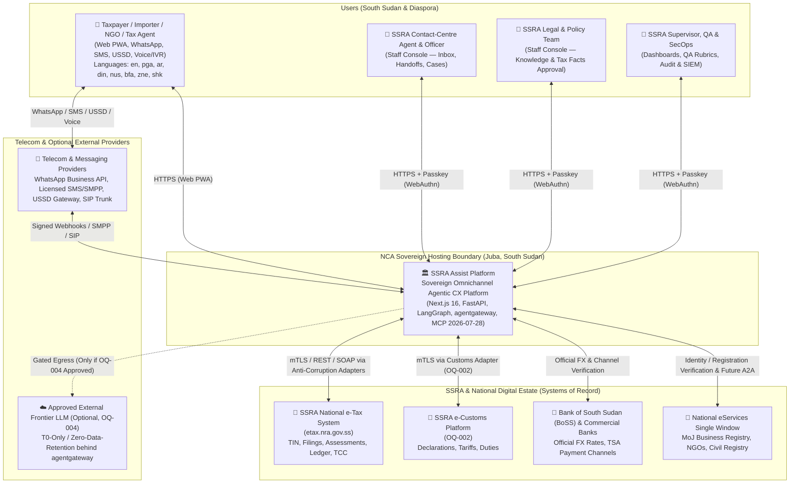
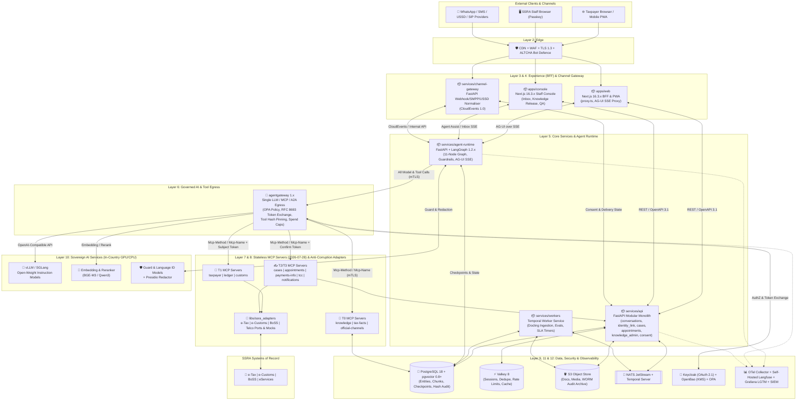
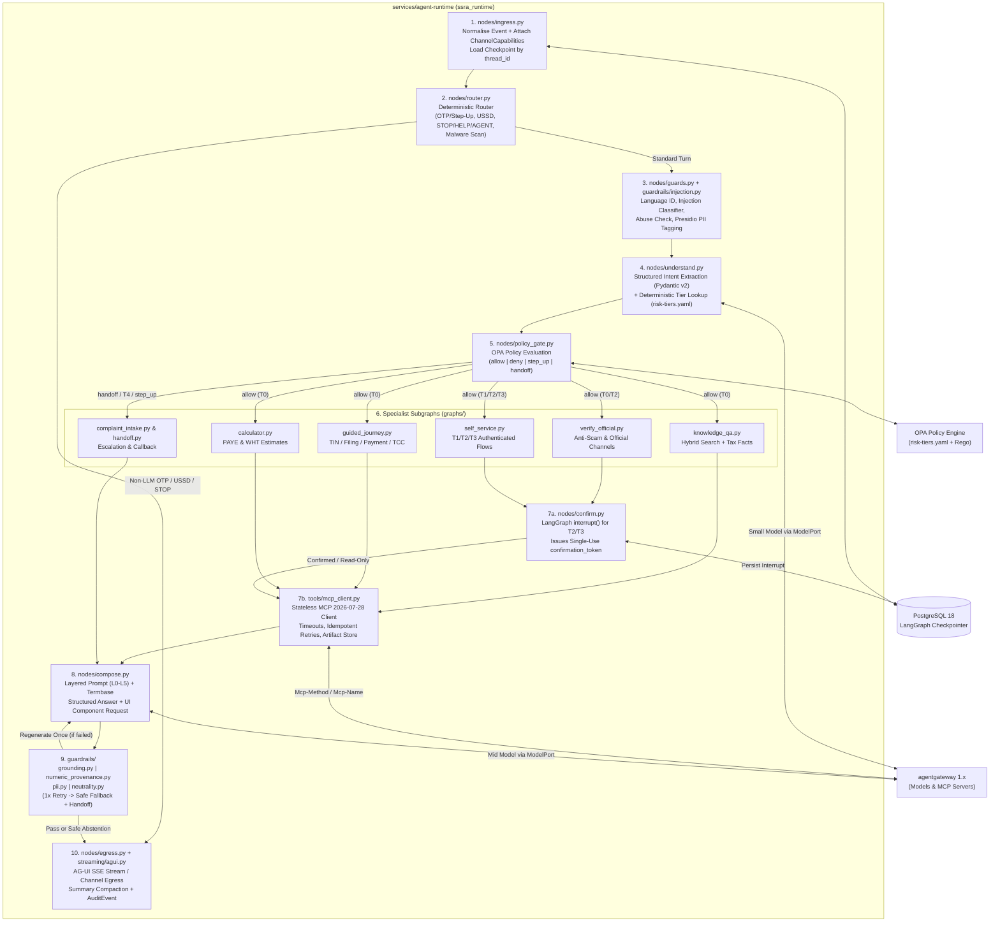
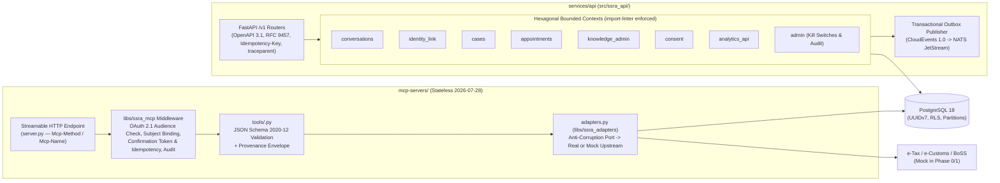
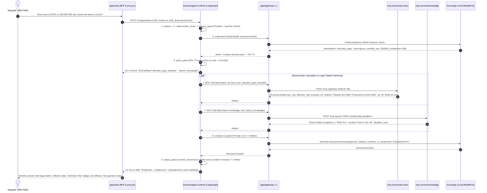
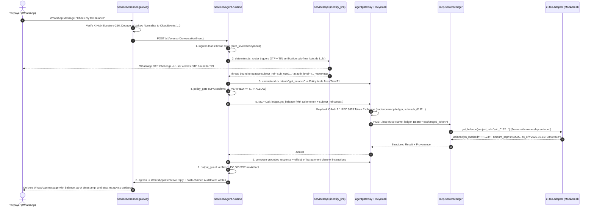

# SSRA Assist — Architecture Overview (C4 Levels 1–3)

**Status:** Draft (Phase 0 Planning — Awaiting Gate 0 Approval)  
**Date:** 2026-10-16  
**Source of Truth:** [`docs/00-master-prompt.md`](../00-master-prompt.md)

---

## 1. Executive Summary & Architectural Posture

**SSRA Assist** is a sovereign, multilingual, omnichannel agentic customer-experience (CX) platform for the **South Sudan Revenue Authority (SSRA)** (formerly the National Revenue Authority, NRA; both names are treated as synonyms across search, content, and intent detection).

It operates strictly as a **governed, intelligent front door** to SSRA's existing e-Tax (`etax.nra.gov.ss`), e-Customs (`OQ-002`), National eServices single window, and Bank of South Sudan (BoSS) banking estate. It is **never** a system of record or a shadow ledger, and it **never** executes payments, refunds, transfers, waivers, penalty remissions, or legal rulings.

### Non-Negotiable Architectural Invariants

1. **Grounded or Silent:** Every factual claim cites an SSRA-approved source (`KnowledgeSnapshot` version, document, section anchor, and effective date). Insufficient evidence triggers abstention and a human handoff offer.
2. **Numbers Come from Tools:** Tax rates, thresholds, deadlines (`Africa/Juba`, UTC+02:00), penalties, balances, and official BoSS exchange rates originate exclusively from deterministic MCP tools (`tax_facts` or authenticated ledger tools). The `numeric_provenance` output validator blocks any numeric claim not traceable to a tool result or cited Tax Fact.
3. **Risk-Tiered Autonomy (T0–T4):** Risk tier is assigned deterministically from `ai/policies/risk-tiers.yaml` by intent and tool—never by the LLM—and enforced at both the `policy_gate` node (OPA) and `agentgateway`.
4. **Single Governed Egress (`agentgateway`):** Every LLM inference request, MCP tool invocation (stateless revision `2026-07-28`), and future A2A v1.0 message transits `agentgateway` with mTLS, OAuth 2.1 RFC 8693 token exchange, per-tool authorization, spend caps, and hash-chained WORM audit logging.
5. **Subject Binding & Zero Trust for Model Arguments:** Identity proofing occurs outside the LLM in the `deterministic_router`. Verified identity is bound to the conversation thread as an opaque `subject_ref` and propagated via RFC 8693 token exchange. Adapters enforce ownership server-side and never trust TIN or identity arguments emitted by a model.
6. **Sovereign & Low-Bandwidth First:** Hosted in-country at the National Communication Authority (NCA) data centre (`OQ-003`) on Kubernetes (RKE2/k3s) using open-weight models (vLLM/SGLang). Designed for 2G/intermittent mobile networks, low-end Android and feature phones, and multilingual inclusivity (`en`, `pga`, `ar` RTL in Phase 1; `din`, `nus`, `bfa`, `zne`, `shk` in Phase 4).

---

## 2. Twelve-Layer Reference Architecture

Every request traverses a strict top-to-bottom pipeline so channels are isolated from intelligence, and intelligence is isolated from systems of record:

| # | Layer | Components | Primary Responsibility |
|---|---|---|---|
| 1 | **Channels** | Web PWA, WhatsApp Business Platform, SMS, USSD, Voice/IVR, Staff Console | Reach taxpayers and staff on the devices and networks they have |
| 2 | **Edge** | CDN, WAF, DDoS & bot defence (ALTCHA PoW), TLS 1.3 | Absorb network/application abuse and terminate TLS 1.3 at the perimeter |
| 3 | **Experience (BFF)** | `apps/web`, `apps/console` (Next.js 16.3.x, `proxy.ts`, Server Components) | Render UI, enforce nonce CSP & Trusted Types, manage `httpOnly` sessions, proxy AG-UI SSE |
| 4 | **Channel Gateway** | `services/channel-gateway` (FastAPI) | Verify webhook signatures, deduplicate deliveries, map sessions, normalise to CloudEvents 1.0 |
| 5 | **Agent Runtime** | `services/agent-runtime` (FastAPI + LangGraph 1.2.x) | Execute deterministic 11-node conversation graph, guardrails, interrupts, and AG-UI streaming |
| 6 | **AI Gateway** | `agentgateway` (1.x) | Single egress for LLM, MCP (`2026-07-28`), and future A2A (`1.0`); OPA policy, token exchange, spend caps, audit |
| 7 | **Domain Tools** | `mcp-servers/*` (Python MCP `2026-07-28` Streamable HTTP) | Expose one governed, schema-validated business capability per tool |
| 8 | **Integration** | `libs/ssra_adapters` (Anti-Corruption Layer) | Adapt e-Tax, e-Customs, BoSS/banks, mobile money, SMS/USSD aggregators, National eServices |
| 9 | **Data** | PostgreSQL 18 + pgvector 0.8+, Valkey 8, S3/MinIO (WORM), NATS JetStream, Temporal | Persist transactional state, hybrid vectors/FTS, caches, objects, event streams, durable workflows |
| 10 | **AI Services** | vLLM / SGLang, Embedding & Reranker servers, ASR/TTS (Whisper / Omnilingual ASR), Guard models | Sovereign in-country inference and speech processing |
| 11 | **Security** | Keycloak (OAuth 2.1 / WebAuthn), OpenBao (Transit KMS/HSM), OPA, cert-manager, mTLS mesh, SIEM | Identity, secrets/encryption, policy-as-code, zero-trust transport, security monitoring |
| 12 | **Platform** | Kubernetes (RKE2/k3s), Argo CD + Rollouts, OpenTofu, Harbor, Kyverno, CloudNativePG, Velero, OTel + LGTM + Langfuse | Provision, verify supply chain (SLSA L3 / Cosign), deploy progressively, observe, and recover |

---

## 3. C4 Level 1 — System Context

### 3.1 Context Description

At the System Context level, **SSRA Assist** sits between two primary user groups (**Taxpayers & Trade Actors** and **SSRA Staff**) and SSRA's authoritative external systems (**National e-Tax System**, **e-Customs Platform**, **Bank of South Sudan & Commercial Banks**, **National eServices Single Window**, and **Telecom / Messaging Aggregators**).

- **Taxpayers** interact via Web PWA (`apps/web`), WhatsApp, SMS, USSD, or Voice/IVR in English (`en`), Juba Arabic (`pga`), Arabic (`ar`), and national languages (`din`, `nus`, `bfa`, `zne`, `shk`) to ask grounded tax/customs questions, run deterministic tax estimates, verify official SSRA channels/accounts against scammers, check their own T1 balances/filings/TCC status (after OTP + TIN verification), and book appointments or open cases (T2).
- **SSRA Staff** (Contact-Centre Agents, Tax/Customs Officers, Supervisors/QA, Legal & Policy Knowledge Owners, ICT/SecOps) use the **Staff Console** (`apps/console`) with WebAuthn passkeys to handle escalated conversations, review AI-drafted cited responses, author/approve/publish immutable `KnowledgeSnapshot` and `TaxFact` releases, and monitor quality and security.
- **External Systems of Record** remain the sole authority for taxpayer registration, assessments, ledger balances, payment references, customs declarations, and exchange rates.

### 3.2 C4 Level 1 Diagram (Mermaid)

---

## 4. C4 Level 2 — Container Architecture

### 4.1 Container Inventory & Responsibilities

Inside the **SSRA Assist** boundary on NCA Kubernetes (RKE2/k3s), the platform is decomposed into independently scalable containers with strict network policies (deny-all by default, mTLS between all internal workloads):

1. **Edge & Ingress (`Edge WAF / Envoy / Ingress`):** Terminates TLS 1.3, enforces WAF rules, DDoS rate limits, and ALTCHA proof-of-work bot verification on public endpoints.
2. **Taxpayer Web PWA (`apps/web` — Next.js 16.3.x standalone):** Public knowledge portal, deterministic calculators, official-channel verifier, and AG-UI chat client. Uses `proxy.ts` for nonce CSP, locale routing (`en`, `pga`, `ar`), and BFF session cookies backed by Valkey.
3. **Staff Console (`apps/console` — Next.js 16.3.x standalone):** Omnichannel agent inbox, AI suggestion review, human takeover/hand-back, Knowledge & Tax Facts release workflow (Draft → Legal Review → Approval → Immutable Publish → Eval Gate → Rollback), and QA/supervisor dashboards. Protected by Keycloak OIDC + WebAuthn passkeys and ASVS 5.0 L3 controls.
4. **Channel Gateway (`services/channel-gateway` — FastAPI):** Terminates webhooks and operator links for WhatsApp Business Platform, SMS (SMPP/HTTP), USSD, and Voice/IVR (`services/voice` in Phase 4). Verifies HMAC signatures, deduplicates message IDs in Valkey, enforces per-sender rate limits, tracks GSM-7 vs. UCS-2 segmentation, and normalises inbound/outbound traffic into `ConversationEvent` (CloudEvents 1.0).
5. **Core API Modular Monolith (`services/api` — FastAPI 0.13x):** Houses eight bounded contexts (`conversations`, `identity_link`, `cases`, `appointments`, `knowledge_admin`, `consent`, `analytics_api`, `admin`), enforcing clean hexagonal boundaries via `import-linter` and publishing domain events via a transactional outbox to NATS JetStream.
6. **Agent Runtime (`services/agent-runtime` — FastAPI + LangGraph 1.2.x):** Stateless worker pool executing the 11-node deterministic supervisor graph and specialist subgraphs, persisting thread checkpoints in PostgreSQL 18, enforcing input/output guardrails (including Presidio PII redaction and numeric provenance), and streaming AG-UI events over SSE.
7. **AI Gateway (`agentgateway` 1.x):** The **only** egress path from `services/agent-runtime` to LLMs, MCP servers, and future A2A peers. Enforces OPA policies on `(caller, subject_ref, auth_level, tool, tier, args_shape)`, performs OAuth 2.1 RFC 8693 token exchange with Keycloak, pins tool description hashes, tracks token/cost budgets, and emits immutable audit records.
8. **Domain MCP Servers (`mcp-servers/*` — Python MCP SDK `2026-07-28`):** Eleven stateless Streamable HTTP servers (`knowledge`, `tax-facts`, `official-channels`, `taxpayer`, `ledger`, `payments-info`, `tcc`, `customs`, `cases`, `appointments`, `notifications`), routed by `agentgateway` via `Mcp-Method` and `Mcp-Name` headers.
9. **Background Workers (`services/workers` — Temporal Python SDK):** Executes durable workflows for Docling document ingestion & legal-structure chunking, embedding/reranking index builds, eval regression suites on knowledge publish, case SLA timers, and consent-checked notification campaigns.
10. **Sovereign AI Inference (`AI Services`):** In-country GPU/CPU inference pods running vLLM/SGLang (open-weight instruction models), embedding/reranker services (BGE-M3 / Qwen3-Embedding + Qwen3-Reranker), guard classifiers, and ASR/TTS (Whisper + Meta Omnilingual ASR in Phase 4).
11. **Data & Messaging Stores:**
    - **PostgreSQL 18 + pgvector 0.8+ (CloudNativePG HA):** Primary relational store (`uuidv7()` keys, monthly partitions, RLS by office/region), hybrid FTS + HNSW vector index with iterative scans, LangGraph checkpointer, and hash-chained `AuditEvent` table.
    - **Valkey 8:** BFF session store, webhook deduplication, rate-limit counters, Next.js shared cache handler, and T0 anonymous semantic cache.
    - **S3-Compatible Object Storage (MinIO / Ceph):** Source legal documents, malware-scanned media attachments, and WORM-locked audit archives.
    - **NATS JetStream:** Event bus for CloudEvents 1.0 (`ConversationEvent`, domain events from transactional outbox).
    - **Temporal Server:** Durable execution engine for `services/workers`.
12. **Security & Observability Plane:** Keycloak (OAuth 2.1 / OIDC / RFC 8693 Token Exchange), OpenBao (secrets + transit encryption), OPA (policy sidecars/service), OpenTelemetry Collector, Langfuse (self-hosted LLM traces & evals), and Grafana LGTM + SIEM.

### 4.2 C4 Level 2 Diagram (Mermaid)

---

## 5. C4 Level 3 — Component Architecture

We detail Level 3 components for the four most critical containers in the request path:
1. **`services/agent-runtime`** (LangGraph deterministic shell + guardrails + AG-UI streaming)
2. **`services/api`** (FastAPI modular monolith & hexagonal bounded contexts)
3. **`mcp-servers/*`** (Stateless `2026-07-28` MCP server internal architecture)
4. **`apps/web`** (Next.js 16.3.x taxpayer PWA, BFF, and Generative UI registry)

---

### 5.1 C4 Level 3 — `services/agent-runtime` (`ssra_runtime`)

#### Component Responsibilities

`services/agent-runtime` is a deterministic state machine built on LangGraph `1.2.x` where LLM calls occur only inside bounded nodes (`understand` and `compose`) and every transition is governed by deterministic code and OPA policy:

1. **AG-UI & Internal Event Ingress (`streaming/agui.py`, `nodes/ingress.py`):** Accepts SSE connections from `apps/web` / `apps/console` or `ConversationEvent` payloads from `services/channel-gateway`. Attaches `ChannelCapabilities` (`max_len`, `rich_ui`, `buttons`, `media`, `latency_budget_ms`, `async_only`) and hydrates `ConversationState` from the PostgreSQL checkpointer by `thread_id`.
2. **Deterministic Router (`nodes/router.py`):** Intercepts non-LLM flows before any model is invoked:
   - OTP challenge/verification and TIN binding (`identity_link` service)
   - USSD menu state transitions (synchronous deterministic path, <2 s)
   - `STOP`, `HELP`, and `AGENT` keywords (immediate consent update or human handoff)
   - Media attachment quarantine to malware-scan + OCR pipeline
3. **Input Guard (`nodes/guards.py`, `guardrails/injection.py`, `guardrails/pii.py`):** Runs language identification (`en`, `pga`, `ar`, `din`, `nus`, `bfa`, `zne`, `shk`), prompt-injection heuristics + classifier, toxicity/abuse filter, and Presidio PII tagging (+211 phones, TINs, national IDs) so logs and traces are masked before storage.
4. **Understand Node (`nodes/understand.py`):** Uses a small, fast model via `ModelPort` (`agentgateway`) with structured output (`Intent` Pydantic v2 schema) to extract `intent`, `slots`, `language`, and `confidence`. Looks up the immutable risk tier (`T0`–`T4`) from `ai/policies/risk-tiers.yaml`—never from the model.
5. **Policy Gate (`nodes/policy_gate.py`):** Evaluates OPA policy (`ai/policies/*.rego`) against `(auth_level, tier, channel, office_hours, rate_limits, safety_flags)` to return one of: `ALLOW`, `DENY`, `STEP_UP_AUTH`, or `HANDOFF`. `T4` intents (`waiver`, `refund`, `penalty_remission`, `dispute`, `legal_ruling`) deterministically route to `handoff` after explaining the official process.
6. **Specialist Subgraphs (`graphs/*.py`):**
   - `knowledge_qa`: Hybrid retrieval (`retrieval/hybrid.py`, `rerank.py`, `filters.py`) via `knowledge` and `tax-facts` MCP servers.
   - `guided_journey`: Step-by-step procedural wizards (TIN registration, e-Tax filing, bank payment, TCC application, customs basics).
   - `calculator`: Invokes deterministic `tax-facts` MCP tools (`calculate_paye_estimate`, `calculate_withholding_estimate`) and labels output explicitly as an estimate.
   - `verify_official`: Invokes `official-channels` MCP tools (`verify_payment_account`, `verify_sender`, `report_scam`) against the anti-impersonation registry.
   - `self_service`: Authenticated `T1`/`T2`/`T3` flows (`taxpayer`, `ledger`, `tcc`, `customs`, `appointments`, `cases`).
   - `complaint_intake` & `handoff`: Minimal-data complaint capture and warm transfer to `services/api` (`Handoff` queue).
7. **Confirmation Interrupt Node (`nodes/confirm.py`):** For `T2` and `T3` state-changing tools, calls LangGraph `interrupt()` with a plain-language action summary and argument digest. When the user confirms via AG-UI `ConfirmActionSheet`, WhatsApp interactive button, or USSD option, issues a short-lived, single-use `confirmation_token` bound to `args_hash` and `idempotency_key`.
8. **Tool Execution Client (`tools/mcp_client.py`):** Invokes MCP servers exclusively through `agentgateway` using stateless MCP `2026-07-28` (`Mcp-Method`, `Mcp-Name`, W3C `traceparent`), enforcing per-tool timeouts, idempotent-only retries, and circuit breakers. Stores tool outputs as typed `Artifact` records referenced by ID.
9. **Compose Node (`nodes/compose.py`):** Assembles the layered prompt (`L0` immutable policy → `L1` channel contract → `L2` persona/tone → `L3` node task → `L4` spotlighted data-only evidence → `L5` minimal tool artifacts), enforces the `ai/termbase/` glossary, and produces a structured `Answer` (`segments[]`, `citations[]`, `numbers[]`, optional registered UI component request).
10. **Output Guard (`guardrails/grounding.py`, `numeric_provenance.py`, `neutrality.py`):** Validates:
    - **Numeric provenance:** Every number in `segments[]` and `numbers[]` matches a `TaxFact` or `Artifact` from the current turn (`100%` gate).
    - **Citation precision & groundedness:** Every claim maps to a published `KnowledgeSnapshot` section or tool provenance.
    - **Cross-subject & PII check:** No unmasked TINs or other-subject data.
    - **Neutrality & non-promise check:** Blocks political commentary or prohibited promises (e.g., *"your penalty will be waived"*).
    - On failure: regenerates at most once with validator feedback; if still failing, emits a safe abstention fallback and offers human handoff.
11. **Egress Node (`nodes/egress.py`):** Streams final AG-UI events or dispatches channel reply, updates running thread summary, writes hash-chained `AuditEvent`, and records OTel GenAI spans.

#### C4 Level 3 Diagram — `services/agent-runtime` (Mermaid)

---

### 5.2 C4 Level 3 — `services/api` (Modular Monolith) & `mcp-servers/*`

#### Component Responsibilities

`services/api` is structured into eight strict hexagonal bounded contexts under `src/ssra_api/<context>/`, enforced by `import-linter` so no context may import another context's `infrastructure/` or `api/` internals:

1. **`conversations`:** Manages `Conversation`, `Message`, `ToolInvocation`, `Confirmation`, and `Handoff` lifecycle; exposes inbox APIs for `apps/console`.
2. **`identity_link`:** Executes deterministic OTP issuance/verification, binds verified TINs to opaque `subject_ref` identifiers, and coordinates RFC 8693 token exchange claims with Keycloak.
3. **`cases`:** Manages taxpayer inquiries, complaints, and scam reports (`Case`), emitting events to Temporal for SLA tracking.
4. **`appointments`:** Manages office slot inventory and booking (`book_appointment`, `cancel_appointment`) across SSRA offices in `Africa/Juba` time.
5. **`knowledge_admin`:** Implements the 6-step Knowledge & Tax Facts Release Workflow (`Draft` → `Legal Review` → `Approval` → `Publish Immutable Snapshot` → `Auto Re-index & Eval Gate` → `One-Step Rollback`).
6. **`consent`:** Maintains the immutable opt-in/opt-out `Consent` ledger checked before any outbound WhatsApp template or SMS notification is sent.
7. **`analytics_api`:** Serves aggregated, de-identified CX funnel, containment, language parity, and content-gap metrics.
8. **`admin`:** Manages official-channel registry entries, kill switches per model/tool/channel, and hash-chained `AuditEvent` verification.

Each MCP server in `mcp-servers/<domain>/` follows `mcp-servers/_template/` and uses `libs/ssra_mcp` to enforce:
- Stateless MCP `2026-07-28` request validation (`_meta` protocol version, `Mcp-Method`, `Mcp-Name`)
- OAuth 2.1 audience-bound JWT verification and `subject_ref` extraction
- Single-use `confirmation_token` + `idempotency_key` enforcement for `T2`/`T3` write tools
- Provenance envelope (`system`, `record_id`, `retrieved_at`, `as_of`, `data_classification`) and typed errors (`NOT_FOUND`, `NOT_AUTHORIZED`, `STEP_UP_REQUIRED`, `UPSTREAM_UNAVAILABLE`, `VALIDATION_FAILED`, `RATE_LIMITED`).

#### C4 Level 3 Diagram — `services/api` & `mcp-servers/*` (Mermaid)

---

### 5.3 C4 Level 3 — `apps/web` & `packages/chat-ui` (Frontend Experience)

#### Component Responsibilities

1. **`src/proxy.ts` (Next.js 16 Proxy):** Generates per-request cryptographic CSP nonces, negotiates locale (`en`, `pga`, `ar` with `dir="rtl"`), enforces security headers (`Trusted-Types`, `HSTS`, `COOP`, `frame-ancestors 'none'`), and gates `/[locale]/(account)/*` routes.
2. **Public Route Group (`app/[locale]/(public)/`):** Uses Next.js 16 Cache Components (`"use cache"`) for ultra-fast, low-bandwidth delivery (<120 KB gzip target) of tax guides, office directory, deterministic PAYE/WHT calculator forms, and the *"Is this really SSRA?"* official-channel verifier.
3. **Chat & Account Route Groups (`app/[locale]/(chat)/`, `app/[locale]/(account)/`):** Lazy-loads `packages/chat-ui` (AG-UI SSE client, offline outbox queue, citation drawer, low-data text-only toggle).
4. **Generative UI Registry (`packages/chat-ui/src/registry/`):** Maps allow-listed component names from the agent (`BalanceCard`, `FilingStatusTimeline`, `PaymentInstructionsCard`, `CalculatorForm`, `CitationList`, `ConfirmActionSheet`, `HandoffCard`) through strict Zod 4 prop schemas. Unknown component names or invalid props safely fall back to plain text. The model never emits raw HTML or JS.
5. **BFF Route Handlers (`app/api/`):** Terminates OIDC (`openid-client` / Better Auth) with Keycloak, manages `httpOnly` session cookies in Valkey, verifies ALTCHA proof-of-work challenges, and proxies resumable AG-UI SSE streams to `services/agent-runtime`.

---

## 6. Key End-to-End Request Sequences

### 6.1 Sequence 1: Phase 0 / Phase 1 Grounded Tax Q&A + Deterministic Calculator (Web PWA, Tier T0)

### 6.2 Sequence 2: Authenticated Balance Query on WhatsApp (Tier T1)

---

## 7. Security, Sovereignty & Trust Boundaries

1. **Public Internet / Telecom Perimeter → Edge Layer:** Untrusted traffic. Protected by TLS 1.3, WAF, rate limiting, webhook HMAC verification, and ALTCHA proof-of-work bot defence.
2. **Experience / Channel Gateway → Agent Runtime:** Internal cluster network with mTLS. User text, uploaded documents, and webhook payloads are tagged as **untrusted data** (`L4` spotlighting delimiters) and never interpolated into `L0`–`L3` system instructions.
3. **Agent Runtime → `agentgateway`:** Single egress choke point enforced by Kubernetes `NetworkPolicy` (the runtime pod has zero network routes to LLMs, MCP servers, or external networks except via `agentgateway`).
4. **`agentgateway` → Domain MCP Servers:** mTLS + OAuth 2.1 audience-scoped JWTs + RFC 8693 subject tokens + single-use confirmation tokens for `T2`/`T3`.
5. **MCP Servers → Systems of Record (`libs/ssra_adapters`):** Anti-corruption layer with circuit breakers, strict timeouts, idempotency keys, and server-side ownership checks. No LLM or user token is ever passed through to e-Tax or e-Customs.

---

## 8. Architecture Decision Records (ADR-001 to ADR-015)

Full index and problem statements are maintained in [`docs/adr/README.md`](../adr/README.md):

| ADR | Title | One-Line Problem Statement | Status |
|---|---|---|---|
| [ADR-001](../adr/0001-record-architecture-decisions.md) | Record Architecture Decisions | How do we govern, document, and evaluate the reversal cost of architectural decisions across SSRA Assist? | Proposed (Drafted) |
| [ADR-002](../adr/0002-service-decomposition-and-modular-monolith.md) | Service Decomposition & Modular Monolith | How do we partition backend responsibilities to balance operational simplicity for SSRA's local team with blast-radius isolation for AI and channels? | Proposed (Drafted) |
| [ADR-003](../adr/0003-orchestration-langgraph-and-temporal.md) | Dual Orchestration: LangGraph & Temporal | How do we separate low-latency, interruptible conversational control flow from long-running, durable background business processes? | Proposed (Drafted) |
| [ADR-004](../adr/0004-mcp-2026-07-28-and-agentgateway-egress.md) | Stateless MCP 2026-07-28 & `agentgateway` Single Egress | How do we expose domain tools and govern all model/tool traffic with zero-trust authorization, auditability, and horizontal scalability? | Proposed (Drafted) |
| [ADR-005](../adr/0005-ag-ui-streaming-and-generative-ui-registry.md) | AG-UI Streaming Protocol & Allow-Listed Generative UI Registry | How do we stream rich, interactive agent responses to low-bandwidth clients without exposing browsers to model-generated HTML/JS injection? | Proposed (Drafted) |
| [ADR-006](../adr/0006-postgresql-18-pgvector-hybrid-retrieval.md) | PostgreSQL 18 + pgvector 0.8+ Hybrid Retrieval | How do we store operational state, checkpoints, and multilingual legal embeddings in one sovereign database before introducing external search engines? | Proposed (Drafted) |
| [ADR-007](../adr/0007-sovereign-model-hosting-and-tiered-routing.md) | Sovereign Open-Weight Model Hosting & Tiered Routing | How do we run LLM inference in-country on NCA infrastructure with a deterministic degradation ladder and strictly gated external fallbacks? | Proposed (Drafted) |
| [ADR-008](../adr/0008-risk-tiered-autonomy-subject-binding-and-opa.md) | Risk-Tiered Autonomy (T0–T4), Subject Binding & OPA Policy Gate | How do we guarantee in code and policy that the assistant cannot leak cross-taxpayer data or execute unauthorized actions? | Proposed (Drafted) |
| [ADR-009](../adr/0009-deterministic-tax-facts-registry-and-numeric-provenance.md) | Deterministic Tax Facts Registry & Numeric Provenance Guard | How do we ensure 100% numeric accuracy on South Sudan tax rates, thresholds, deadlines, and calculations with zero hallucinated figures? | Proposed (Drafted) |
| [ADR-010](../adr/0010-nextjs-16-typescript-7-turborepo-and-biome.md) | Next.js 16.3.x, TypeScript 7, Turborepo & Biome Frontend Stack | How do we build and type-check two secure, low-bandwidth Next.js 16 applications sharing one RTL-ready design system? | Proposed (Drafted) |
| [ADR-011](../adr/0011-low-bandwidth-taxpayer-pwa-and-service-worker.md) | Low-Bandwidth Taxpayer PWA & Service Worker Strategy | How do we deliver an offline-capable, 2G-resilient PWA under Next.js 16 and Turbopack within a 150 KB gzip first-load budget? | Proposed (Drafted) |
| [ADR-012](../adr/0012-bff-authentication-keycloak-passkeys-and-sessions.md) | BFF Authentication with Keycloak OIDC, Passkeys & Server Sessions | How do we authenticate taxpayers (OTP+TIN) and staff (WebAuthn passkeys) while keeping all OAuth tokens out of browser JavaScript? | Proposed (Drafted) |
| [ADR-013](../adr/0013-python-314-315-fastapi-and-asgi-server.md) | Python 3.14/3.15 Workspace, FastAPI 0.13x & ASGI Server Selection | How do we standardise the Python monorepo toolchain (`uv`, Ruff, basedpyright) and evaluate Uvicorn vs. Granian for container deployments? | Proposed (Drafted) |
| [ADR-014](../adr/0014-future-a2a-v1-interoperability-boundary.md) | Future Agent-to-Agent (A2A v1.0) Interoperability Boundary | How do we reserve a governed boundary for future multi-agency collaboration with South Sudan's National eServices platform? | Proposed (Drafted) |
| [ADR-015](../adr/0015-supply-chain-hardening-and-sovereign-gitops.md) | Supply-Chain Hardening (SLSA L3, 7-Day Cooldown) & Sovereign GitOps | How do we defend CI/CD, dependencies, and container images against 2026-class supply-chain compromises (such as the March 2026 LiteLLM/Trivy incident)? | Proposed (Drafted) |
