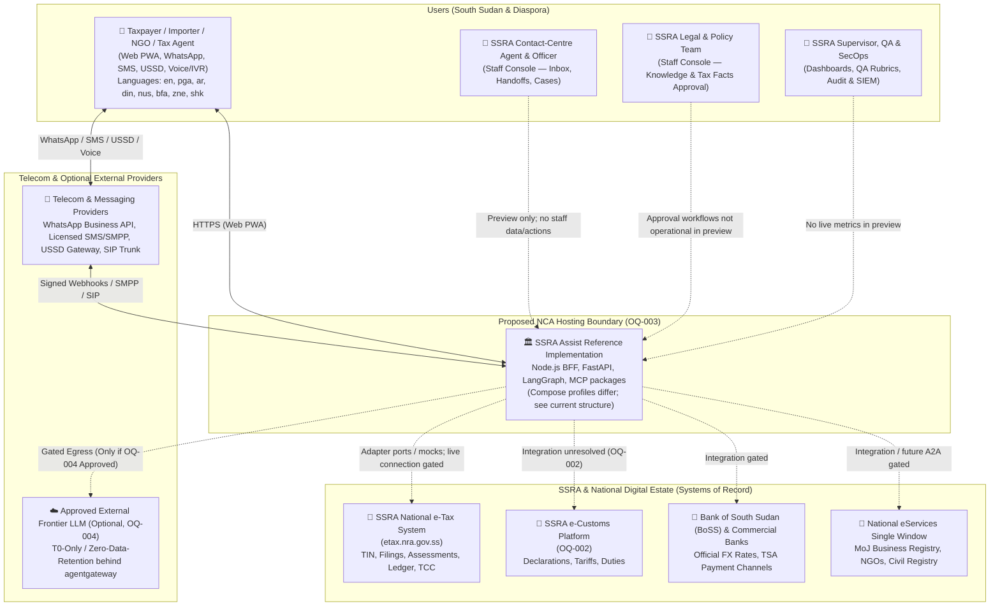
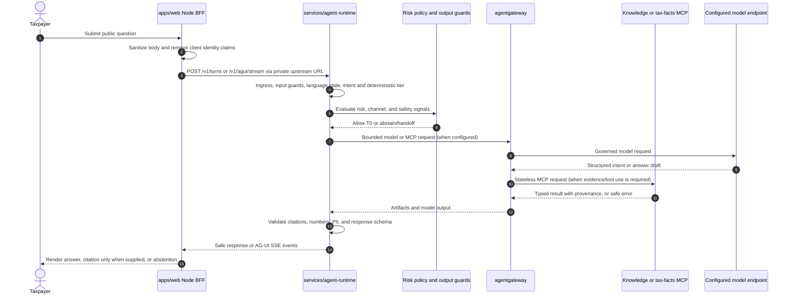
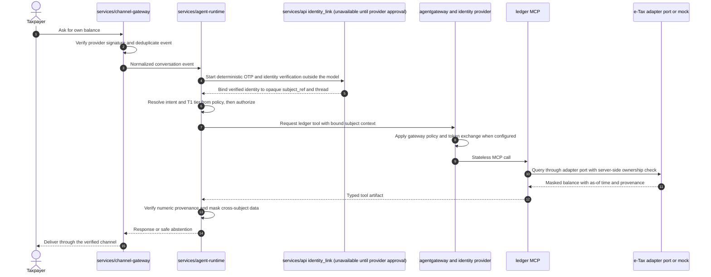
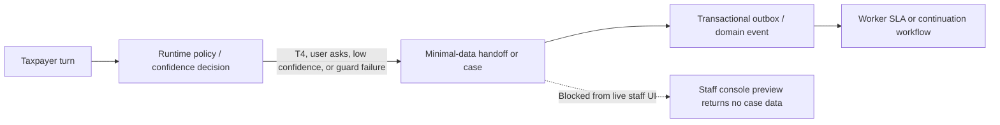

# SSRA Assist — Architecture Overview (C4 Levels 1–3)

**Status:** Reference implementation architecture (phases 0–4 code present; production deployment and live integrations remain separately gated)
**Reconciled:** 2026-10-21
**Source of Truth:** [`docs/00-master-prompt.md`](../00-master-prompt.md)

---

## 1. Executive Summary & Architectural Posture

**SSRA Assist** is the reference implementation for a proposed sovereign, multilingual, omnichannel agentic customer-experience (CX) platform for the **South Sudan Revenue Authority (SSRA)** (formerly the National Revenue Authority, NRA; both names are treated as synonyms across search, content, and intent detection).

It operates strictly as a **governed, intelligent front door** to SSRA's existing e-Tax (`etax.nra.gov.ss`), e-Customs (`OQ-002`), National eServices single window, and Bank of South Sudan (BoSS) banking estate. It is **never** a system of record or a shadow ledger, and it **never** executes payments, refunds, transfers, waivers, penalty remissions, or legal rulings.

### Non-Negotiable Architectural Invariants

1. **Grounded or Silent:** Every factual claim cites an SSRA-approved source (`KnowledgeSnapshot` version, document, section anchor, and effective date). Insufficient evidence triggers abstention and a human handoff offer.
2. **Numbers Come from Tools:** Tax rates, thresholds, deadlines (`Africa/Juba`, UTC+02:00), penalties, balances, and official BoSS exchange rates originate exclusively from deterministic MCP tools (`tax_facts` or authenticated ledger tools). The `numeric_provenance` output validator blocks any numeric claim not traceable to a tool result or cited Tax Fact.
3. **Risk-Tiered Autonomy (T0–T4):** Risk tier is assigned deterministically from `ai/policies/risk-tiers.yaml` by intent and tool—never by the LLM—and enforced at both the `policy_gate` node (OPA) and `agentgateway`.
4. **Single Governed Egress (`agentgateway`):** The architecture requires every LLM inference request and MCP tool invocation (stateless revision `2026-07-28`) to transit the governed gateway. The general Compose profile declares the gateway; the GPU profile does not, so that profile must not be treated as satisfying this invariant until its egress path is verified. Future A2A v1.0 traffic also requires this gate.
5. **Subject Binding & Zero Trust for Model Arguments:** Identity proofing occurs outside the LLM in the `deterministic_router`. Verified identity is bound to the conversation thread as an opaque `subject_ref` and propagated via RFC 8693 token exchange. Adapters enforce ownership server-side and never trust TIN or identity arguments emitted by a model.
6. **Sovereign & Low-Bandwidth First:** Docker Compose is the current container-operation direction (ADR-016); NCA hosting remains an open deployment decision (`OQ-003`). The experience is designed for intermittent mobile networks, low-end Android and feature phones. UI assets include eight locales, while legal/tax content requires qualified language review before publication.

### Current Repository Structure & Implementation State

This repository contains reference implementations, two local Compose base profiles, and a production/disaster-recovery Compose overlay. Code being present does not mean that an upstream government system is connected, a staff user is authenticated, or the stack is approved for production. The live source tree and the current trust boundary are:

| Area | Current location and responsibility | Current boundary / status |
|---|---|---|
| Taxpayer experience | `apps/web/server.js` serves the Node.js HTTP/BFF shell; `apps/web/src/app/` holds route modules; `packages/chat-ui`, `packages/ui`, and `packages/i18n` provide chat, shared UI, and locale assets. | Browser chat is sent through `/api/turns` or `/api/chat/stream`, where request data is sanitized before forwarding to the runtime. Direct browser `/v1/*` access is denied except feedback. The server-side BFF is the current runnable entry point in Compose. |
| Staff console and dashboards | `apps/console/server.js`, `apps/console/src/`, and `packages/ui/ops-console.js` provide navigation and dashboard preview structure. | **Non-operational preview.** Persona choice affects navigation only; scorecard, flags, kill-switch, knowledge-release, and stack-status data/action APIs fail closed with `403 NOT_AUTHORIZED` (or 503 for missing operational telemetry). Do not treat preview dashboards as live. OQ-013 and OQ-014 block operational analytics and staff access. |
| Shared contracts and clients | `packages/contracts/` owns JSON Schema; `packages/api-client/` contains generated API types; `tools/codegen/` and `task gen` generate cross-language artifacts. | Contracts are the boundary between TypeScript UI and Python services; generated files should not be edited as the source of truth. |
| Core API | `services/api/src/ssra_api/` is the FastAPI modular monolith with conversations, identity link, cases, appointments, knowledge admin, consent, analytics, and admin contexts. | `SSRA_RUNTIME_MODE` defaults to `production`; the API returns 503 unless explicit `reference` mode is selected because current stores/providers are incomplete. Identity, document, appointment, and operational analytics routes fail closed even in reference mode; synthetic operational scorecard generators have been removed. |
| Conversation runtime and policy | `services/agent-runtime/src/ssra_runtime/` contains the LangGraph conversation graph, guards, planner/verifier, memory, retrieval, MCP client, replay, and AG-UI streaming; `ai/policies/` contains risk and feature-flag policy. | The current graph uses LangGraph `InMemorySaver` (process-local state). Runtime requests and health checks return 503 unless explicit `reference` mode is selected; durable checkpoints and safe multi-replica continuation are not established. |
| Governed tools and adapters | `mcp-servers/` contains 11 domain server packages; `libs/ssra_mcp/` supplies shared transport/security; `libs/ssra_adapters/` defines upstream ports. | e-Tax/e-Customs and other external integrations must be verified independently; typed ports and mocks are not evidence of a live system-of-record connection. |
| Channel, voice, and durable work | `services/channel-gateway/`, `services/voice/`, and `services/workers/` contain channel adapters, voice flows, and ingestion/SLA/continuation workers. | Their presence in source does not mean every adapter/worker is included in each Compose profile or connected to an approved provider. |
| Shared backend libraries | `libs/ssra_core/`, `libs/ssra_security/`, `libs/ssra_rules/`, `libs/ssra_llm/`, `libs/ssra_mcp/`, `libs/ssra_adapters/`, and `libs/ssra_testing/`. | Common IDs, clock, contracts, policy/security, deterministic rules, model routing, MCP transport, upstream ports, and test factories. |
| Knowledge, evaluation, and operations | `knowledge/`, `evals/`, `infra/`, and `tools/` hold approved knowledge inputs, evaluation/red-team suites, Compose/security/observability configuration, and code-generation/verification utilities. | Seed data and synthetic test fixtures are not live taxpayer or legal data. |

#### Local Compose Profiles

The Compose files are not identical deployment topologies:

| Profile | Declared components | Important limits |
|---|---|---|
| `infra/compose/docker-compose.yml` | PostgreSQL + pgvector, Valkey, NATS, Keycloak, Core API, external `agentgateway` image, agent runtime, channel gateway, taxpayer frontend, and staff console. | This is the general local service stack; it does not declare all 11 MCP servers, voice services, or workers as services. It is not proof of an NCA production deployment. |
| `infra/compose/docker-compose.gpu.yml` | Local model servers, TTS, PostgreSQL, Valkey, Qdrant, Core API, agent runtime, taxpayer frontend, and staff console. | This benchmark profile does not declare `agentgateway`, Keycloak, NATS, channel gateway, MCP server containers, or workers. Treat it as a GPU/reference profile until governed egress and identity wiring are independently verified. |
| `infra/compose/docker-compose.yml` + `infra/compose/docker-compose.prod.yml` (`--profile prod` / `dr`) | The production/DR overlay extends the general stack with PostgreSQL WAL archiving, secret mounts, pinned inference services, and resource controls. | This is a production-intended configuration artifact, not evidence of an active NCA deployment, complete DR validation, or approval to connect live government systems. |

ADR-016 records Docker Compose as the current container-operation direction; the Kubernetes/RKE2/k3s items in earlier reference material are not the current Compose deployment baseline. NCA hosting and production authorization remain subject to OQ-003 and SSRA approval.

---

## 2. Twelve-Layer Reference Architecture

This logical pipeline separates channels, orchestration, policy, and systems of record. Profile-specific omissions and external deployment boundaries are called out below; the diagram must not be read as a single currently deployed topology.

| # | Layer | Components | Primary Responsibility |
|---|---|---|---|
| 1 | **Channels** | Web PWA, WhatsApp Business Platform, SMS, USSD, Voice/IVR, Staff Console | Reach taxpayers and staff on the devices and networks they have |
| 2 | **Edge** | External CDN/WAF/ingress (not declared in local Compose); application-level security headers and route checks | Target perimeter controls must be supplied and verified by the deployment environment |
| 3 | **Experience (BFF)** | `apps/web/server.js`, `apps/console/server.js`, route modules under `src/` | Render public chat and staff preview, apply browser-to-service BFF routing, enforce response headers, sanitize turns, and deny private direct proxy paths |
| 4 | **Channel Gateway** | `services/channel-gateway` (FastAPI) | Verify webhook signatures, deduplicate deliveries, map sessions, normalise to CloudEvents 1.0 |
| 5 | **Agent Runtime** | `services/agent-runtime` (FastAPI + LangGraph 1.2.x) | Execute deterministic 11-node conversation graph, guardrails, interrupts, and AG-UI streaming |
| 6 | **AI Gateway** | `agentgateway` (1.x) | Single egress for LLM, MCP (`2026-07-28`), and future A2A (`1.0`); OPA policy, token exchange, spend caps, audit |
| 7 | **Domain Tools** | `mcp-servers/*` (Python MCP `2026-07-28` Streamable HTTP) | Expose one governed, schema-validated business capability per tool |
| 8 | **Integration** | `libs/ssra_adapters` (Anti-Corruption Layer) | Adapt e-Tax, e-Customs, BoSS/banks, mobile money, SMS/USSD aggregators, National eServices |
| 9 | **Data** | PostgreSQL 18 + pgvector, Valkey, general-profile NATS, GPU-profile Qdrant | Persist relational state, knowledge retrieval, cache state, outbox events, and profile-specific memory vectors; S3/Temporal remain integration targets outside these Compose profiles |
| 10 | **AI Services** | GPU-profile local vLLM, TTS, embedding/reranker, and guard-model services where configured | Provide inference and speech processing; local execution does not establish NCA hosting or production model approval |
| 11 | **Security** | Keycloak in general Compose; OPA/OpenBao/security libraries and audit controls in source/config | Identity, secrets/encryption, policy-as-code, transport, and monitoring coverage must be verified per deployment profile |
| 12 | **Platform** | Hardened Docker Compose profiles (`infra/compose/`), pinned OCI images, local model cache, PostgreSQL/Valkey and profile-specific NATS/Qdrant | Run and observe the local/reference stacks. NCA hosting, progressive delivery, backup/restore, and production recovery still require environment-specific approval and evidence. |

---

## 3. C4 Level 1 — System Context

### 3.1 Context Description

At the target System Context level, **SSRA Assist** sits between **Taxpayers & Trade Actors**, **SSRA Staff**, and SSRA's authoritative external systems. The external systems remain system-of-record boundaries; the local code and mock adapters do not establish that live integrations exist.

- **Taxpayers** use the public web experience today; channel, authenticated self-service, and staff-assisted journeys are represented by code and reference flows. T1–T3 journeys require verified identity, risk policy, and approved upstream adapters before live use. UI assets cover `en`, `pga`, `ar`, `din`, `nus`, `bfa`, `zne`, and `shk`; legal/tax content requires qualified language review.
- **SSRA Staff** have a non-operational console preview today. Live case review, AI takeover/hand-back, knowledge publication, and analytics require server-verified staff identity, approved role mapping, provenance-bearing data, and audited APIs (ADR-018; OQ-013 and OQ-014).
- **External Systems of Record** remain the sole authority for taxpayer registration, assessments, ledger balances, payment references, customs declarations, and exchange rates.

### 3.2 C4 Level 1 Diagram (Mermaid)



---

## 4. C4 Level 2 — Container Architecture

### 4.1 Container Inventory & Responsibilities

This is the logical container inventory inside the SSRA Assist boundary. The general/GPU Compose base profiles do not deploy every listed component together; the production/DR overlay extends the general profile. None of these files proves an active NCA deployment:

1. **Edge & Ingress (environment supplied):** The Compose base profiles and production/DR overlay do not declare a CDN/WAF or ingress controller. Public TLS termination and perimeter controls must be verified in the target environment; application servers provide their own request and response controls.
2. **Taxpayer Web PWA (`apps/web`):** The runnable Compose entry point is the Node.js HTTP/BFF server in `server.js`; route modules and `proxy.ts` are also present under `src/`. Browser chat goes through `/api/turns` or `/api/chat/stream`, with sanitized payloads forwarded to the runtime. Direct browser `/v1/*` access is denied except feedback.
3. **Staff Console (`apps/console`):** The runnable server is `server.js` and currently serves a non-operational preview. Staff data and action routes return `403 NOT_AUTHORIZED`; workbench and dashboard modules are not a live inbox or telemetry source (ADR-018, OQ-013, OQ-014).
4. **Channel Gateway (`services/channel-gateway` — FastAPI):** Source code includes WhatsApp and USSD handling and shared event normalization. It is declared in the general Compose stack, not in the GPU benchmark profile. Provider connectivity and channel coverage are deployment-specific.
5. **Core API Modular Monolith (`services/api` — FastAPI):** Houses eight bounded contexts (`conversations`, `identity_link`, `cases`, `appointments`, `knowledge_admin`, `consent`, `analytics_api`, `admin`), persistence helpers, and an outbox schema plus process-local reference buffer. `SSRA_RUNTIME_MODE` defaults to `production`; API requests return 503 unless explicit `reference` mode is selected. Identity/document, appointment, and analytics routes remain unavailable until approved providers exist. PostgreSQL schemas do not mean current handlers have durable persistence. Server-verified staff identity remains a prerequisite for staff data/actions.
6. **Agent Runtime (`services/agent-runtime` — FastAPI + LangGraph):** Contains deterministic conversation routing, specialist graphs, planning, retrieval, guardrails, memory, replay, MCP client, and AG-UI streaming. Runtime policy and provenance controls must remain active in every deployment profile.
7. **AI Gateway (`agentgateway`):** The general Compose stack includes a pinned external `agentgateway` image and the repository includes gateway enforcement code. The GPU benchmark Compose file does not declare an `agentgateway` service; governed egress in that profile must be verified before use.
8. **Domain MCP Servers (`mcp-servers/*`):** Eleven server packages exist (`knowledge`, `tax-facts`, `official-channels`, `taxpayer`, `ledger`, `payments-info`, `tcc`, `customs`, `cases`, `appointments`, `notifications`) and implement stateless Streamable HTTP. The two Compose files do not declare all 11 as individual containers.
9. **Background Workers:** `services/workers/` contains ingestion, SLA, campaign, and continuation workflow code. Temporal-backed durable execution is an integration target; Temporal is not a service in the general, GPU, or production/DR Compose files described above.
10. **AI Inference:** The GPU profile declares local vLLM model servers and TTS; deployment location and model availability depend on the host. Do not infer in-country NCA hosting from a local GPU run.
11. **Data & Messaging Stores:** PostgreSQL 18 + pgvector backs relational records and knowledge retrieval in both local profiles; Valkey is present in both. The GPU profile adds Qdrant for episodic vector memory. NATS is included in the general and inherited production/DR profiles, but not the GPU profile. S3-compatible object storage and Temporal are architecture/worker integration targets and are not declared as services in these Compose files.
12. **Security & Observability Plane:** Keycloak is configured in the general Compose profile; OpenBao, OPA, telemetry, and audit components are represented in source/configuration. A deployment must verify which controls are provisioned and connected rather than infer coverage from this logical inventory.

### 4.2 C4 Level 2 Diagram (Mermaid)

```mermaid
flowchart TB
    subgraph Clients["External Clients & Channels"]
        Browser["🌐 Taxpayer Browser / Mobile PWA"]
        StaffBrowser["🖥️ SSRA Staff Browser (preview; trusted session gate pending)"]
        WAGateway["📱 WhatsApp / SMS / USSD / SIP Providers"]
    end

    subgraph EdgeLayer["Layer 2: Edge"]
        WAF["🛡️ External CDN / WAF / TLS termination\nNot declared in local Compose"]
    end

    subgraph ExperienceLayer["Layer 3 & 4: Experience (BFF) & Channel Gateway"]
        WebPWA["📦 apps/web\nNode.js HTTP BFF + PWA shell\n(/api/turns, /api/chat/stream)"]
        ConsoleApp["📦 apps/console\nNode.js staff preview\n(no staff data/actions; APIs return 403)"]
        ChanGW["📦 services/channel-gateway\nFastAPI Webhook/SMPP/USSD Normaliser\n(CloudEvents 1.0)"]
    end

    subgraph CoreAndRuntime["Layer 5: Core Services & Agent Runtime"]
        CoreAPI["📦 services/api\nFastAPI Modular Monolith\n(8 bounded contexts)"]
        Runtime["📦 services/agent-runtime\nFastAPI + LangGraph 1.2.x\n(11-Node Graph, Guardrails, AG-UI SSE)"]
        Workers["📦 services/workers\nWorker code\n(Temporal integration target)"]
    end

    subgraph GovernanceGateway["Layer 6: Governed AI & Tool Egress"]
        AgentGW["🚦 agentgateway\nDeclared in general Compose only\n(GPU profile parity not established)"]
    end

    subgraph DomainTools["Layer 7 & 8: Stateless MCP Servers (2026-07-28) & Anti-Corruption Adapters"]
        MCP_T0["🔧 T0 MCP Servers\nknowledge | tax-facts | official-channels"]
        MCP_T1["🔐 T1 MCP Servers\ntaxpayer | ledger | customs"]
        MCP_T2_T3["✍️ T2/T3 MCP Servers\ncases | appointments | payments-info | tcc | notifications"]
        Adapters["🔌 libs/ssra_adapters\ne-Tax | e-Customs | BoSS | Telco Ports & Mocks"]
    end

    subgraph SovereignAI["Layer 10: Local / Sovereign AI Services (deployment dependent)"]
        vLLM["🧠 vLLM / SGLang\nOpen-Weight Instruction Models"]
        Embed["🔎 Embedding & Reranker\n(BGE-M3 / Qwen3)"]
        GuardModels["🛡️ Guard & Language ID Models\n+ Presidio Redactor"]
    end

    subgraph DataAndSecurity["Layer 9, 11 & 12: Data, Security & Observability"]
        GraphState[("LangGraph InMemorySaver\n(process-local conversation state)")]
        PG[("🐘 PostgreSQL 18 + pgvector\n(Relational state, knowledge chunks)")]
        Valkey[("⚡ Valkey 8\n(Sessions, Dedupe, Rate Limits, Cache)")]
        Qdrant[("🔎 Qdrant\n(GPU profile episodic vectors)")]
        NATS[["📨 NATS JetStream\n(general profile)"]]
        SecPlane["🔑 Keycloak (OAuth 2.1) + OpenBao (KMS) + OPA"]
        ObsPlane["📊 OTel Collector + Self-Hosted Langfuse + Grafana LGTM + SIEM"]
    end

    subgraph Upstreams["SSRA Systems of Record"]
        SOR["🏦 e-Tax | e-Customs | BoSS | eServices"]
    end

    Browser --> WAF
    StaffBrowser --> WAF
    WAGateway --> WAF

    WAF --> WebPWA
    WAF --> ConsoleApp
    WAF --> ChanGW

    WebPWA -.->|"Feedback route only"| CoreAPI
    WebPWA <-->|"AG-UI over SSE"| Runtime
    ConsoleApp -.->|"Staff data/actions denied until trusted session gate"| CoreAPI
    ChanGW <-->|"CloudEvents / Internal API"| Runtime
    ChanGW <-->|"Consent & Delivery State"| CoreAPI

    CoreAPI -.->|"ORM/database configuration; repository adoption incomplete"| PG
    CoreAPI -.->|"Service dependency; context wiring varies"| Valkey
    CoreAPI -.->|"General profile; outbox delivery wiring varies"| NATS
    Workers -.->|"when Temporal/NATS are provisioned"| NATS
    Workers -.->|"when worker persistence is provisioned"| PG

    Runtime -->|"Current graph checkpointer"| GraphState
    Runtime <-->|"Episodic vector memory (GPU profile)"| Qdrant
    Runtime <-->|"Cache / ephemeral state"| Valkey
    Runtime <-->|"Guard & Redaction"| GuardModels
    Runtime -->|"All Model & Tool Calls (mTLS)"| AgentGW

    AgentGW <-->|"AuthZ & Token Exchange"| SecPlane
    AgentGW -->|"OpenAI-Compatible API"| vLLM
    AgentGW -->|"Embedding / Rerank"| Embed
    AgentGW -->|"Mcp-Method / Mcp-Name (mTLS)"| MCP_T0
    AgentGW -->|"Mcp-Method / Mcp-Name + Subject Token"| MCP_T1
    AgentGW -->|"Mcp-Method / Mcp-Name + Confirm Token"| MCP_T2_T3

    MCP_T0 <--> PG
    MCP_T1 --> Adapters
    MCP_T2_T3 --> Adapters
    MCP_T2_T3 --> CoreAPI
    Adapters <--> SOR

    Runtime -.-> ObsPlane
    AgentGW -.-> ObsPlane
    CoreAPI -.-> ObsPlane
```



---

## 5. C4 Level 3 — Component Architecture

We detail Level 3 components for the four most critical containers in the request path:
1. **`services/agent-runtime`** (LangGraph deterministic shell + guardrails + AG-UI streaming)
2. **`services/api`** (FastAPI modular monolith & hexagonal bounded contexts)
3. **`mcp-servers/*`** (Stateless `2026-07-28` MCP server internal architecture)
4. **apps/web** (Node.js BFF/PWA shell plus shared chat UI packages)

---

### 5.1 C4 Level 3 — `services/agent-runtime` (`ssra_runtime`)

#### Component Responsibilities

`services/agent-runtime` is a deterministic state machine built on LangGraph `1.2.x` where LLM calls occur only inside bounded nodes (`understand` and `compose`) and every transition is governed by deterministic code and OPA policy:

1. **AG-UI & Internal Event Ingress:** Accepts SSE requests from apps/web or ConversationEvent payloads from services/channel-gateway, attaches ChannelCapabilities, and hydrates turn state through the current LangGraph InMemorySaver. This reference checkpointer is process-local, not PostgreSQL-backed.
2. **Deterministic Router (`nodes/router.py`):** Intercepts non-LLM flows before any model is invoked:
   - Identity and OTP verification is an intended flow only; current identity endpoints return 503 until approved providers are configured.
   - USSD menu state transitions (synchronous deterministic path, <2 s)
   - `STOP`, `HELP`, and `AGENT` keywords (immediate consent update or human handoff)
   - Media attachment quarantine to malware-scan + OCR pipeline is a target flow; document endpoints return 503 and the UI reports analysis unavailable until approved providers are configured.
3. **Input Guard (`nodes/guards.py`, `guardrails/injection.py`, `guardrails/pii.py`):** Runs language identification (`en`, `pga`, `ar`, `din`, `nus`, `bfa`, `zne`, `shk`), prompt-injection heuristics + classifier, toxicity/abuse filter, and Presidio PII tagging (+211 phones, TINs, national IDs) so logs and traces are masked before storage.
4. **Understand Node (`nodes/understand.py`):** Uses a small, fast model via `ModelPort` (`agentgateway`) with structured output (`Intent` Pydantic v2 schema) to extract `intent`, `slots`, `language`, and `confidence`. Looks up the immutable risk tier (`T0`–`T4`) from `ai/policies/risk-tiers.yaml`—never from the model.
5. **Policy Gate (`nodes/policy_gate.py`):** Evaluates OPA policy (`ai/policies/*.rego`) against `(auth_level, tier, channel, office_hours, rate_limits, safety_flags)` to return one of: `ALLOW`, `DENY`, `STEP_UP_AUTH`, or `HANDOFF`. `T4` intents (`waiver`, `refund`, `penalty_remission`, `dispute`, `legal_ruling`) deterministically route to `handoff` after explaining the official process.
6. **Specialist Subgraphs (`graphs/*.py`):**
   - `knowledge_qa`: Hybrid retrieval (`retrieval/hybrid.py`, `rerank.py`, `filters.py`) via `knowledge` and `tax-facts` MCP servers.
   - `guided_journey`: Step-by-step procedural wizards (TIN registration, e-Tax filing, bank payment, TCC application, customs basics).
   - `calculator`: Invokes deterministic `tax-facts` MCP tools (`calculate_paye_estimate`, `calculate_withholding_estimate`) and labels output explicitly as an estimate.
   - `verify_official`: Invokes `official-channels` MCP tools (`verify_payment_account`, `verify_sender`, `report_scam`) against the anti-impersonation registry.
   - `self_service`: Authenticated `T1`/`T2`/`T3` flows (`taxpayer`, `ledger`, `tcc`, `customs`, `appointments`, `cases`).
   - `complaint_intake` & `handoff`: Minimal-data complaint capture and warm transfer to `services/api` (`Handoff` queue).
7. **Confirmation Interrupt Node (`nodes/confirm.py`):** For `T2` and `T3` state-changing tools, calls LangGraph `interrupt()` with a plain-language action summary and argument digest. When the user confirms via AG-UI `ConfirmActionSheet`, WhatsApp interactive button, or USSD option, issues a short-lived, single-use `confirmation_token` bound to `args_hash` and `idempotency_key`.
8. **Tool Execution Client (`tools/mcp_client.py`):** Invokes MCP servers exclusively through `agentgateway` using stateless MCP `2026-07-28` (`Mcp-Method`, `Mcp-Name`, W3C `traceparent`), enforcing per-tool timeouts, idempotent-only retries, and circuit breakers. Stores tool outputs as typed `Artifact` records referenced by ID.
9. **Compose Node (`nodes/compose.py`):** Assembles the layered prompt (`L0` immutable policy → `L1` channel contract → `L2` persona/tone → `L3` node task → `L4` spotlighted data-only evidence → `L5` minimal tool artifacts), enforces the `ai/termbase/` glossary, and produces a structured `Answer` (`segments[]`, `citations[]`, `numbers[]`, optional registered UI component request).
10. **Output Guard (`guardrails/grounding.py`, `numeric_provenance.py`, `neutrality.py`):** Validates:
    - **Numeric provenance:** Every number in `segments[]` and `numbers[]` matches a `TaxFact` or `Artifact` from the current turn (`100%` gate).
    - **Citation precision & groundedness:** Every claim maps to a published `KnowledgeSnapshot` section or tool provenance.
    - **Cross-subject & PII check:** No unmasked TINs or other-subject data.
    - **Neutrality & non-promise check:** Blocks political commentary or prohibited promises (e.g., *"your penalty will be waived"*).
    - On failure: regenerates at most once with validator feedback; if still failing, emits a safe abstention fallback and offers human handoff.
11. **Egress Node (`nodes/egress.py`):** Streams final AG-UI events or dispatches channel reply, updates running thread summary, writes hash-chained `AuditEvent`, and records OTel GenAI spans.

#### C4 Level 3 Diagram — `services/agent-runtime` (Mermaid)


---

### 5.2 C4 Level 3 — `services/api` (Modular Monolith) & `mcp-servers/*`

#### Component Responsibilities

`services/api` is structured into eight bounded contexts under `src/ssra_api/<context>/`, with import boundaries enforced by `import-linter`. The current routes are reference implementations: several use in-process stores, and the PostgreSQL migration/ORM declarations are not evidence that those routes persist through PostgreSQL.

1. **`conversations`:** Conversation creation uses `InMemoryConversationRepository`; staff inbox, streaming, copilot, takeover/handback, and QA routes return 403 until OQ-014's server-verified session/role integration exists. There is no durable account history or staff inbox persistence.
2. **`identity_link`:** Request/response schemas remain, but no application/domain implementation or provider is active. Identity, OTP, SIM-swap, document precheck, and document analysis endpoints return 503 until approved integrations and durable identity binding exist.
3. **`cases`:** Contains inquiry/complaint handlers, but case state and outbox staging are in-process; Temporal SLA delivery is a target integration, not a running Compose service.
4. **`appointments`:** The slots endpoint returns 503 until an approved office inventory provider is configured (OQ-016); fixed, expired fixtures are no longer returned.
5. **`knowledge_admin`:** The release workflow engine holds snapshots in memory. Its draft, review, approval, publish, rollback, and status APIs all return 403 until OQ-014 staff authorization and OQ-015 durable state are implemented. The state machine is currently exercised directly in tests only.
6. **`consent`:** The current preference store is in-process; it is not a durable consent ledger for live outbound messaging.
7. **`analytics_api`:** Summary, insight, drift, and scorecard endpoints return 503 until OQ-013's governed warehouse, freshness controls, and metric provenance are approved. The console remains a separate 403 preview under OQ-014.
8. **`admin`:** Kill-switch, feature-flag, audit, and JIT endpoints return 403 until a server-verified staff session and role policy exist. The public status endpoint returns 503 until trusted health telemetry and freshness provenance are configured; a browser persona or request field is not identity (ADR-018; OQ-013–OQ-015).

Each MCP server in `mcp-servers/<domain>/` follows `mcp-servers/_template/` and uses `libs/ssra_mcp` to enforce:
- Stateless MCP `2026-07-28` request validation (`_meta` protocol version, `Mcp-Method`, `Mcp-Name`)
- OAuth 2.1 audience-bound JWT verification and `subject_ref` extraction
- Single-use `confirmation_token` + `idempotency_key` enforcement for `T2`/`T3` write tools
- Provenance envelope (`system`, `record_id`, `retrieved_at`, `as_of`, `data_classification`) and typed errors (`NOT_FOUND`, `NOT_AUTHORIZED`, `STEP_UP_REQUIRED`, `UPSTREAM_UNAVAILABLE`, `VALIDATION_FAILED`, `RATE_LIMITED`).

#### C4 Level 3 Diagram — `services/api` & `mcp-servers/*` (Mermaid)

```mermaid
flowchart LR
    subgraph ModularMonolith["services/api (src/ssra_api/)"]
        direction TB
        API_Router["FastAPI /v1 Routers\n(OpenAPI 3.1, RFC 9457, Idempotency-Key, traceparent)"]
        subgraph Contexts["Hexagonal Bounded Contexts (import-linter enforced)"]
            C_Conv["conversations"]
            C_Id["identity_link"]
            C_Cases["cases"]
            C_Appt["appointments"]
            C_Know["knowledge_admin"]
            C_Consent["consent"]
            C_Analytics["analytics_api"]
            C_Admin["admin (Kill Switches & Audit)"]
        end
        Outbox["In-process Outbox Store\n(CloudEvents staging; durable NATS delivery not established)"]
        API_Router --> Contexts
        Contexts --> Outbox
    end

    subgraph MCPServerTemplate["mcp-servers/<domain> (Stateless 2026-07-28)"]
        direction TB
        MCPHttp["Streamable HTTP Endpoint\n(server.py — Mcp-Method / Mcp-Name)"]
        MCPBase["libs/ssra_mcp Middleware\nOAuth 2.1 Audience Check, Subject Binding,\nConfirmation Token & Idempotency, Audit"]
        ToolHandler["tools/<verb_noun>.py\nJSON Schema 2020-12 Validation\n+ Provenance Envelope"]
        PortAdapter["adapters.py (libs/ssra_adapters)\nAnti-Corruption Port -> Real or Mock Upstream"]
        MCPHttp --> MCPBase --> ToolHandler --> PortAdapter
    end

    PG[("PostgreSQL 18\n(UUIDv7, RLS, Partitions)")]
    NATS[["NATS JetStream\n(general profile; runtime publisher not established)"]]
    ETaxAdapter["e-Tax / e-Customs / BoSS\n(Mock in Phase 0/1)"]

    Contexts -.->|"Database mapping exists; current repository wiring incomplete"| PG
    Outbox -.->|"Broker delivery not established"| NATS
    PortAdapter --> PG
    PortAdapter --> ETaxAdapter
```



---

### 5.3 C4 Level 3 — Taxpayer Web, Shared Chat UI, and Staff Preview

#### Component Responsibilities

1. **Runnable taxpayer entry point:** `apps/web/server.js` is the Node.js HTTP/BFF server used by the Compose frontend container. Route modules and `proxy.ts` also exist under `apps/web/src/`; their presence does not change the runnable container entry point.
2. **Public chat BFF:** `POST /api/turns` and `POST /api/chat/stream` sanitize browser payloads before forwarding to the runtime. Direct browser calls to `/v1/*` are denied except the feedback endpoint. The BFF must not accept a browser-selected `subject_ref` or use local storage as authentication.
3. **Main chat and sidebar:** The browser client served by `apps/web/server.js` keeps anonymous T0 conversation history on the device. Search, recency groups, pin/rename/delete, and sidebar state are presentation features; they do not query a staff or taxpayer account history. Offline responses must not claim a live citation or snapshot.
4. **Shared UI packages:** `packages/chat-ui/` contains AG-UI stream handling, offline queues/resilience, voice/document flows, and shared chat components. `packages/ui/` and `packages/i18n/` supply shared widgets, icons, and locale strings. The allow-listed generative UI surface is limited to the registered seven card types; unknown or invalid payloads must fall back safely.
5. **Staff preview:** `apps/console/server.js` serves the staff navigation/dashboard preview. The API endpoints for scorecard, feature flags, kill switches, and runtime status fail closed until a server-verified staff session and approved roles are available. Preview persona selection is not an identity or permission.
6. **Trustworthy dashboard state:** No operational metric is displayed as live without a source, observation time, and freshness state. OQ-013 and OQ-014 block operational dashboard data and staff actions (ADR-018).

#### Service and Risk Design References

Reviewed 2026-10-21. These are evidence-informed design references; they do not replace South Sudan law, SSRA approval, or user research with South Sudanese taxpayers and staff:

- **Accessibility:** Use WCAG 2.2 AA as the project baseline and prefer the latest W3C WCAG version. Automated accessibility checks do not establish full conformance or substitute for disabled-user testing and assistive-technology/device review. See the [W3C WCAG 2.2 Recommendation](https://www.w3.org/TR/WCAG22/) and [GOV.UK accessibility guidance](https://www.gov.uk/service-manual/helping-people-to-use-your-service/making-your-service-accessible-an-introduction).
- **Government service flow:** Treat the GOV.UK Service Standard as a comparative practice: make the complete service simple across online and offline steps, and test the service with actual and potential users. This is not asserted as a binding SSRA standard. See [Point 4: Make the service simple to use](https://www.gov.uk/service-manual/service-standard/point-4-make-the-service-simple-to-use).
- **Generative-AI risk:** Use the NIST AI RMF and Generative AI Profile as voluntary risk-management references for governing, measuring, and managing model risks. As of this review, NIST says AI RMF 1.0 is being revised and its April 2026 critical-infrastructure profile is a concept note; do not describe either as a newly finalized October 2026 standard. See [NIST AI RMF](https://www.nist.gov/itl/ai-risk-management-framework) and [NIST AI RMF resources](https://www.nist.gov/itl/ai-risk-management-framework/ai-risk-management-framework-resources).


## 6. Key End-to-End Request Sequences

### 6.1 Anonymous public chat turn (T0)

This sequence describes the code path and policy contract. MCP/model requests must use the governed gateway; the GPU Compose profile does not declare the gateway and requires separate egress verification. Any example taxpayer text is synthetic.



### 6.2 Authenticated balance query on WhatsApp (T1 reference flow)

This is the intended trust path, not evidence of a live SSRA WhatsApp or e-Tax connection. The HTTP identity route returns 503; no live taxpayer-directory, OTP, or SIM-swap provider or durable identity binding is established. No local OTP use case is active. This flow cannot verify or bind a real taxpayer until OQ-005 is approved and implemented.



### 6.3 Staff dashboard preview (current behavior)

```mermaid
sequenceDiagram
    autonumber
    actor Staff as Staff reviewer
    participant Console as apps/console preview server

    Staff->>Console: Open a preview persona or dashboard page
    Console-->>Staff: Render navigation and preview notice
    Staff->>Console: Request scorecard, flags, kill-switch, or stack status
    Console-->>Staff: Return 403 and show unavailable state; no live values or success receipt
```

The preview never authorizes staff actions. A future operational flow requires server-verified OIDC identity and role claims, action-level authorization, provenance-bearing metrics, confirmation/idempotency where required, and an audit receipt.

### 6.4 Human handoff and staff review boundary (reference flow)

The runtime and API contain handoff/case and SLA workflow components, but case and outbox state are currently process-local and Temporal is not in the Compose profiles. This reference flow does not establish durable handoff delivery. The current console preview cannot consume staff data until OQ-013 and OQ-014 are resolved.




## 7. Security, Sovereignty & Trust Boundaries

1. **Public Internet / Telecom Perimeter → Edge Layer:** Untrusted traffic. CDN/WAF/TLS perimeter controls are supplied by the target environment; the application includes security headers, route controls, and challenge handling.
2. **Experience / Channel Gateway → Agent Runtime:** User text and webhook payloads remain untrusted. Local Compose provides network separation; mTLS is a deployment control that must be configured and verified separately.
3. **Agent Runtime → agentgateway:** The general Compose profile places services on the sovereign internal network and declares the gateway. The GPU profile does not declare a gateway, and neither local profile proves a Kubernetes NetworkPolicy or a production egress boundary; verify the actual route before use.
4. **agentgateway → Domain MCP Servers:** The governed path requires transport protection, audience-scoped authorization, subject binding, and single-use confirmation for T2/T3. Confirm these controls in the active profile.
5. **MCP Servers → Systems of Record (`libs/ssra_adapters`):** Anti-corruption layer with circuit breakers, strict timeouts, idempotency keys, and server-side ownership checks. No LLM or user token is ever passed through to e-Tax or e-Customs.

---

## 8. Major Design Decisions

The full ADR catalog, status, context, options, consequences, and reversal costs are maintained in [docs/adr/README.md](../adr/README.md). The main decisions represented by the current architecture are:

| Decision area | Decision recorded | ADR status |
|---|---|---|
| Service boundaries | Keep the Core API as a modular monolith; isolate the agent runtime, channel gateway, workers, and domain tools as separate packages/services where deployment requires them. | [ADR-002](../adr/0002-service-decomposition-and-modular-monolith.md), proposed/drafted |
| Conversation and durable work | Use an explicit LangGraph conversation flow for bounded turns and Temporal for durable background workflows; the current runtime checkpointer is InMemorySaver and is not durable across process restarts. | [ADR-003](../adr/0003-orchestration-langgraph-and-temporal.md), proposed/drafted |
| Tool and model egress | Use stateless MCP 2026-07-28 and a single governed agentgateway path. The general Compose profile declares the gateway; the GPU profile needs egress-parity verification. | [ADR-004](../adr/0004-mcp-2026-07-28-and-agentgateway-egress.md), proposed/drafted |
| Risk, identity, and tax figures | Assign T0–T4 from policy, bind verified identity outside the model, use deterministic tax facts, and validate numeric provenance. | [ADR-008](../adr/0008-risk-tiered-autonomy-subject-binding-and-opa.md) and [ADR-009](../adr/0009-deterministic-tax-facts-registry-and-numeric-provenance.md), proposed/drafted |
| Retrieval and memory | Use PostgreSQL/pgvector for relational and knowledge retrieval; GPU profile configures Qdrant for episodic vectors. The persistence wiring and migrations are described in docs/architecture/data-model.md. | [ADR-006](../adr/0006-postgresql-18-pgvector-hybrid-retrieval.md), proposed/drafted; [ADR-017](../adr/0017-agentic-cx-eq-4tier-memory-and-goal-continuation.md), accepted |
| Container and model baseline | Use hardened Docker Compose as the current container-operation direction and local model services as profile-specific components; NCA production hosting remains gated. | [ADR-016](../adr/0016-docker-compose-2026-and-sunflower-qwen35-9b.md), accepted |
| Staff console trust | Keep the console as a non-operational preview until server-verified staff identity, authorization, and metric provenance exist. | [ADR-018](../adr/0018-staff-console-preview-and-trusted-session-gate.md), accepted |
| Frontend streaming and safe UI | Use BFF-mediated chat requests, typed streaming, and a closed generative UI component set; client state is not authorization. | [ADR-005](../adr/0005-ag-ui-streaming-and-generative-ui-registry.md), [ADR-010](../adr/0010-nextjs-16-typescript-7-turborepo-and-biome.md), [ADR-011](../adr/0011-low-bandwidth-taxpayer-pwa-and-service-worker.md), proposed/drafted |

ADR-001 through ADR-015 remain Proposed (Drafted) in the catalog unless their individual records say otherwise. ADR-016, ADR-017, and ADR-018 are Accepted.
