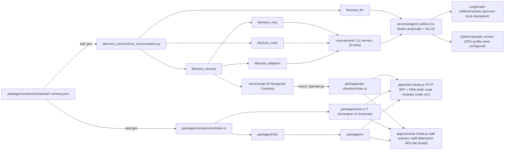

# SSRA Assist (`ssra-cx`) — Codebase Knowledge Graph Report (`graphify-out/GRAPH_REPORT.md`)

**Generated:** 2026-10-16 · **Reconciled with source:** 2026-10-24
**Governance (Section 19):** Read this graph report before broad file exploration. Contains zero secrets or taxpayer PII.

---

## 1. Architectural Topology & Module Dependency Graph

---

## 2. Key Entry Points by Domain

| Domain | Path | Key Exports / Responsibilities |
|---|---|---|
| **Master Spec & ADRs** | `docs/00-master-prompt.md`, `docs/adr/` | Single source of truth + `ADR-001` through `ADR-029` |
| **Contracts & Codegen** | `packages/contracts/`, `tools/codegen/` | `ConversationEvent`, `Intent`, `Answer`, `TaxFact`, `AffectiveSnapshot`, `EnglishRouterEnvelope`, `HandoffEnvelope`, OpenAPI 3.1 snapshot |
| **Core & Clock** | `libs/ssra_core/` | `new_uuid7()`, `compute_monthly_filing_deadline()`, `Africa/Juba` (`UTC+02:00`), `FeatureFlagEngine` (`flags.py`), OTel GenAI & Agentic CX spans |
| **Security & Crypto** | `libs/ssra_security/` | `TokenExchangeService` (RFC 8693), `ConfirmationTokenManager`, `redact_pii`, `OpenBaoTransitEncryptor`, `HashChainedAuditLedger` |
| **Deterministic Rules** | `libs/ssra_rules/`, `knowledge/tax-facts/` | `TaxFactsRegistry`, `calculate_paye_estimate`, `calculate_withholding_estimate` |
| **LLM & Degradation** | `libs/ssra_llm/`, `ai/` | `PromptRegistry` (`L0`–`L5` spotlighting), `SovereignModelRouter` (5-step ladder), `AnonymousT0SemanticCache` |
| **MCP `2026-07-28`** | `libs/ssra_mcp/`, `mcp-servers/*` | `StatelessMcpServer` + 11 domain servers (`knowledge`, `tax-facts`, `official-channels`, `taxpayer`, `ledger`, `payments-info`, `tcc`, `customs`, `cases`, `appointments`, `notifications`) |
| **Agent Runtime** | `services/agent-runtime/` | `SSRAConversationRuntime` (11-node LangGraph, multi-turn `prior_intent`/`prior_slots`/`workflow_stack` carry-over per `ADR-028`), `eq_detector.py`, `language_state.py`, `planner.py` (compound T0/T1 plans), `verifier.py` (`_detect_quiet_tool_fault` / `QUIET_FAULT_DETECTED`), `mcp_client.py` (turn-scoped read memoization, `TOOL_LOOP_DETECTED`, `bound_overlong_tool_output`), 4-tier `memory.py`, `numeric_provenance.py`, `streaming/agui.py` |
| **Core API Monolith** | `services/api/` | 8 bounded contexts (`conversations`, `identity_link`, `cases`, `appointments`, `knowledge_admin`, `consent`, `analytics_api`, `admin`), `database.py`, `outbox.py` |
| **Channel Gateway** | `services/channel-gateway/` | WhatsApp HMAC & 24h window (`whatsapp.py`), SMS GSM-7/UCS-2, USSD 182-char menu (`ussd.py`) |
| **Workers & Voice** | `services/workers/`, `services/voice/` | Legal chunker (`ingestion.py`), SLA timers (`sla.py`), Temporal goal continuation (`continuation.py`), Whisper + Omnilingual ASR WER gate (`APPROVED_VOICE_WER_EVIDENCE`) + `VoiceCallSession` (`POST_TTS_ECHO_COOLDOWN_MS = 450`, `is_likely_tts_echo`, `is_backchannel_utterance` per `ADR-027`) + EQ TTS prosody |
| **Frontend Experience** | `apps/web/server.js`, `apps/console/server.js`, `packages/*` | Node BFF routes `/api/turns` and `/api/chat/stream`; browser direct `/v1/*` denied except feedback; public history is device-local T0; the Gemini-style rail (`--rail-bg`, scroll-fade separation, Sign in/Register linked to `/signin` and `/signup`, Settings gear) sits beside a main canvas with a transparent in-canvas header, `.ssra-main-gradient`, and a centred landing (`#main-content[data-view]`, pill composer, rotating `#composer-placeholder`, three `#landing-prompts`); includes `CallScreen` (`CallOrb`, `CallLanguageChip`, live caption thread, Mute/Officer/Callback/Hangup dock) and Main Chat Input voice/speech controls (`NarrationBar`, `.composer-active-recording`, `#composer-voicemode-btn`, `useVoiceEscape`); the console shares the public assistant's design language (light canvas with the `#C7D2FE` glow, `#1E40AF` 56/248px rail, pill buttons, ink-only status labels) and remains preview-only when unauthenticated (`403 AUTHENTICATED_STAFF_SESSION_REQUIRED` on `/api/*` and `/v1/*`) and routes authenticated `ssra_admin` (`/admin`), `ssra_staff` (`/agent`), and `ssra_auditor` (`/analytics` read-only) sessions to their role-scoped workbenches |
| **Persistence & deployment profiles** | `services/api/alembic/`, `services/api/src/ssra_api/database.py`, `infra/compose/` | PostgreSQL migration `0001` defines relational schema; runtime graph, several API repositories, and outbox staging are process-local; no identity OTP flow is active; ORM memory models lack tables in migration `0001`; GPU Compose adds Qdrant but omits `agentgateway`, Keycloak, and NATS from the general profile; production/DR Compose overlay adds WAL archiving and secret mounts but is not evidence of an active deployment |
| **Evaluation Harness** | `evals/suites/`, `evals/redteam/` | 600-item Phase 1 golden dataset (`300 en`, `150 ar`, `150 pga`), trajectory/channel checks, OWASP `ASI01`–`ASI10` red-team |

---

## 3. Current Trust and Persistence Notes (2026-10-24)

- `apps/web/server.js` sanitizes public chat turns before forwarding to the runtime and denies direct browser proxy access to private `/v1/*` routes other than feedback.
- `apps/console/server.js` is a non-operational preview. Browser persona selection is presentation state only; staff inbox, conversation action, case approval, admin control, and console data/action APIs fail closed until trusted sessions and role mapping are integrated.
- `services/agent-runtime/src/ssra_runtime/graphs/conversation.py` uses LangGraph `InMemorySaver`; it is not a durable database checkpointer.
- `SSRA_RUNTIME_MODE` defaults to production; API and agent-runtime requests return 503 outside explicit reference mode. Identity/document, appointment, and operational analytics endpoints also fail closed in reference mode until approved providers exist.
- Admin controls, JIT elevation, staff inbox/actions, and case maker-checker return 403 in every mode until OQ-014 is closed; public service status returns 503 until trusted health telemetry is configured.
- No identity-link application or domain helpers remain active. The attachment inspection view shows an unavailable state and does not generate OCR results, portal instructions, TIN checks, or statutory calculations.
- `InMemoryOutboxBuffer` rejects overflow without evicting events and refuses to claim NATS publication. The migrated outbox table and NATS service do not establish durable broker delivery.
- The GPU Compose profile declares Qdrant for episodic vectors but does not declare the general profile's `agentgateway`, Keycloak, or NATS services. Verify egress, identity, and outbox wiring before treating it as a deployment topology.
- `infra/compose/docker-compose.prod.yml` is an overlay on the general profile with production/DR configuration, including PostgreSQL WAL archiving and secret mounts. Its presence does not establish that the overlay is deployed or that recovery objectives have been exercised.
- See [`docs/architecture/overview.md`](../docs/architecture/overview.md) and [`docs/architecture/data-model.md`](../docs/architecture/data-model.md) for the full component map and persistence caveats.
