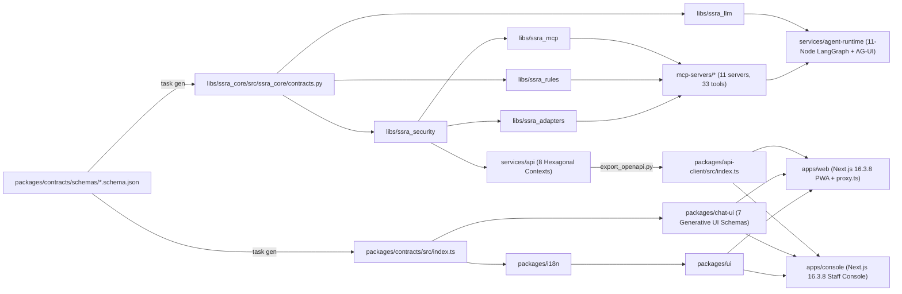

# SSRA Assist (`ssra-cx`) — Codebase Knowledge Graph Report (`graphify-out/GRAPH_REPORT.md`)

**Generated:** 2026-10-16  
**Governance (Section 19):** Read this graph report before broad file exploration. Contains zero secrets or taxpayer PII.

---

## 1. Architectural Topology & Module Dependency Graph

---

## 2. Key Entry Points by Domain

| Domain | Path | Key Exports / Responsibilities |
|---|---|---|
| **Master Spec & ADRs** | `docs/00-master-prompt.md`, `docs/adr/` | Single source of truth + `ADR-001` through `ADR-015` |
| **Contracts & Codegen** | `packages/contracts/`, `tools/codegen/` | `ConversationEvent`, `Intent`, `Answer`, `TaxFact`, OpenAPI 3.1 snapshot |
| **Core & Clock** | `libs/ssra_core/` | `new_uuid7()`, `compute_monthly_filing_deadline()`, `Africa/Juba` (`UTC+02:00`), OTel GenAI spans |
| **Security & Crypto** | `libs/ssra_security/` | `TokenExchangeService` (RFC 8693), `ConfirmationTokenManager`, `redact_pii`, `OpenBaoTransitEncryptor`, `HashChainedAuditLedger` |
| **Deterministic Rules** | `libs/ssra_rules/`, `knowledge/tax-facts/` | `TaxFactsRegistry`, `calculate_paye_estimate`, `calculate_withholding_estimate` |
| **LLM & Degradation** | `libs/ssra_llm/`, `ai/` | `PromptRegistry` (`L0`–`L5` spotlighting), `SovereignModelRouter` (5-step ladder), `AnonymousT0SemanticCache` |
| **MCP `2026-07-28`** | `libs/ssra_mcp/`, `mcp-servers/*` | `StatelessMcpServer` + 11 domain servers (`knowledge`, `tax-facts`, `official-channels`, `taxpayer`, `ledger`, `payments-info`, `tcc`, `customs`, `cases`, `appointments`, `notifications`) |
| **Agent Runtime** | `services/agent-runtime/` | `SSRAConversationRuntime` (11-node LangGraph), `numeric_provenance.py`, `streaming/agui.py` |
| **Core API Monolith** | `services/api/` | 8 bounded contexts (`conversations`, `identity_link`, `cases`, `appointments`, `knowledge_admin`, `consent`, `analytics_api`, `admin`), `database.py`, `outbox.py` |
| **Channel Gateway** | `services/channel-gateway/` | WhatsApp HMAC & 24h window (`whatsapp.py`), SMS GSM-7/UCS-2, USSD 182-char menu (`ussd.py`) |
| **Workers & Voice** | `services/workers/`, `services/voice/` | Legal chunker (`ingestion.py`), SLA timers (`sla.py`), Whisper + Omnilingual ASR WER gate |
| **Frontend Experience** | `apps/web/`, `apps/console/`, `packages/*` | `proxy.ts` nonce CSP, ALTCHA PoW (`altcha.ts`), AG-UI SSE parser, T0 offline outbox, 7-card Generative UI registry |
| **Evaluation Harness** | `evals/suites/`, `evals/redteam/` | 600-item Phase 1 golden dataset (`300 en`, `150 ar`, `150 pga`), trajectory/channel checks, OWASP `ASI01`–`ASI10` red-team |
